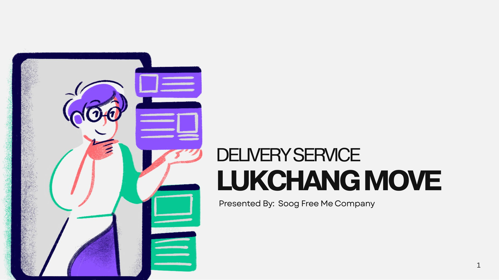

# Lukchang Move

<figure><figcaption>
Lukchang Move · Delivery Service
</figcaption></figure>

**Lukchang Move** คือแพลตฟอร์มบริการส่งพัสดุที่ช่วยให้ผู้ส่งระบุขนาดและประเภทของพัสดุได้ชัดเจน หาผู้ขับที่ผ่านการตรวจสอบตัวตน (KYC) และติดตามพัสดุได้ตั้งแต่ต้นจนจบ โดยมี **AI Support Chatbot** คอยตอบคำถามและส่งต่อเคสให้ Admin เมื่อจำเป็น

โครงงานนี้เป็นส่วนหนึ่งของรายวิชา Advanced Computer Engineering พัฒนาโดยทีม **Soog Free Me Company** ซึ่งแบ่งงานเป็น 3 ทีม คือ Software, Systems และ Network

## สิ่งที่อยู่ในรายงานนี้

| หมวด | เนื้อหา |
| --- | --- |
| Overview | ปัญหา โซลูชัน กลุ่มผู้ใช้ และทีมงาน |
| UX/UI Design | หน้าจอแอปผู้ส่ง ผู้ขับ Admin และ User Flow |
| Software Architecture | Tech Stack, สถาปัตยกรรมซอฟต์แวร์ และการทดสอบ |
| Data & Storage | Capacity, QPS และการออกแบบที่เก็บข้อมูล |
| AI: Support Chatbot | Hybrid Classifier + LLM, Support Tiers และผลการทดสอบ |
| Cloud Deployment | System Diagram บน AWS Bangkok และเหตุผลการออกแบบ |
| MLOps | ML Deployment, MLOps Pipeline และ ML Monitoring |
| Private Datacenter | Rack, Server & Storage, ระบบไฟฟ้า, ระบบทำความเย็น และงบประมาณ |
| Network Design | Topology, อุปกรณ์, Redundancy และ Network Services |
| Project | การบริหารโครงการ ทีมงาน และบทสรุป |
