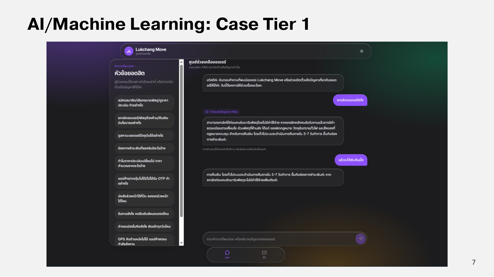

# Demo

หน้าศูนย์ช่วยเหลือออเดอร์มีรายการ "หัวข้อยอดฮิต" ด้านซ้าย และปุ่มคำถามด่วน เช่น ออเดอร์ของฉันสถานะอะไร, ยกเลิกออเดอร์ยังไง, พัสดุมาถึงแล้วแต่แตก ขอเงินคืนได้ไหม, ค่าคอมมิชชั่นคิดยังไง



<figure><figcaption>
Demo Case Tier 1
</figcaption></figure>




วิดีโอ Demo Case Tier 2





วิดีโอ Demo Case Tier 3




