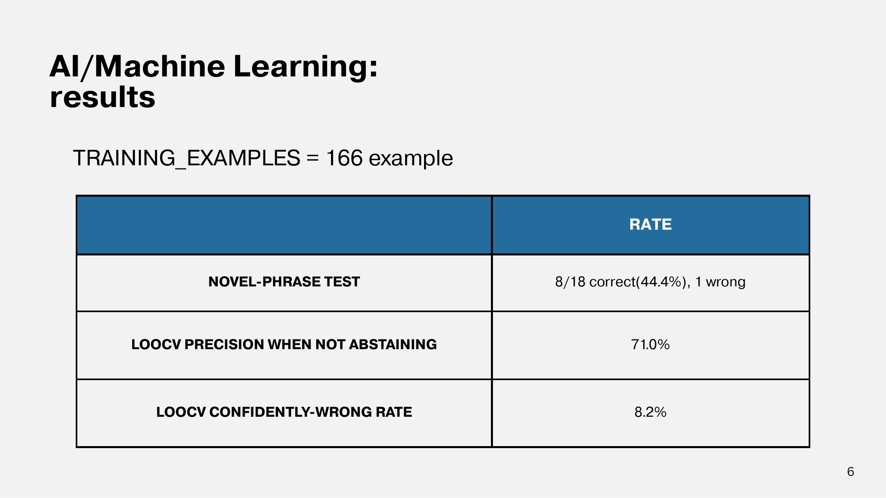

# Evaluation

<figure><figcaption>
ผลการทดสอบ FAQ Classifier
</figcaption></figure>

| การทดสอบ | ผล | ความหมาย |
| --- | --- | --- |
| Training examples | 166 ตัวอย่าง | ขนาด dataset ที่ใช้เทรน |
| Novel-phrase test | 8/18 ถูก (44.4%), ผิด 1 | ประโยคที่โมเดลไม่เคยเห็น ส่วนที่เหลือโมเดล abstain |
| LOOCV precision เมื่อไม่ abstain | 71.0% | เมื่อโมเดลเลือกตอบ ตอบถูก 71% |
| LOOCV confidently-wrong rate | 8.2% | สัดส่วนที่โมเดลมั่นใจแต่ตอบผิด |

## การตีความผล

ตัวเลขยังไม่สูง เพราะ dataset มีเพียง 166 ตัวอย่าง แต่ระบบออกแบบให้ Classifier เป็นด่านแรกเท่านั้น เมื่อไม่มั่นใจ ระบบจะ **ไม่ตอบเอง (abstain)** แล้วส่งต่อให้ LLM หรือ Admin สิ่งที่สำคัญที่สุดจึงเป็นการคุม confidently-wrong rate ให้ต่ำ

ในการ deploy มีเกณฑ์ว่า novel-phrase test และ confidently-wrong ต้องไม่เกินเกณฑ์ก่อนปล่อยโมเดลใหม่ ส่วน LLM ใช้ eval set ที่วัดว่าตอบถูก route ticket ถูกทีม และ escalate ไม่พลาด


สไลด์ Final บางฉบับเขียนว่า 12/18 (44.4%) แต่ 44.4% เท่ากับ 8/18 ตามผลใน Progress 3 หน้านี้ใช้ 8/18

