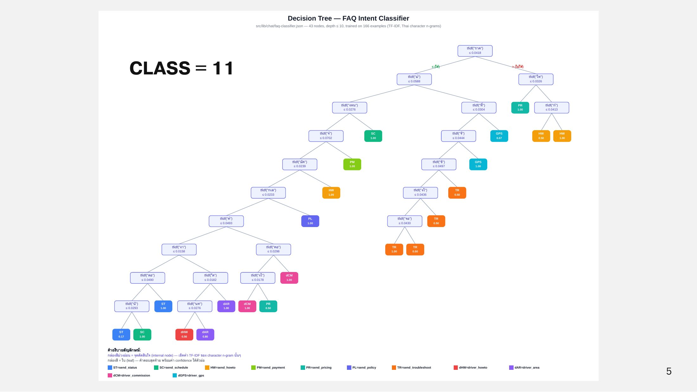

# Dataset & Model

## FAQ Classifier: Decision Tree + TF-IDF

<figure><figcaption>
Decision Tree ของ FAQ Intent Classifier (43 nodes)
</figcaption></figure>

| รายการ | ค่า |
| --- | --- |
| โมเดล | Decision Tree |
| Feature | TF-IDF ของ character n-gram (bigram, trigram) |
| ขนาดโมเดล | 43 nodes, depth ≤ 10 |
| Training examples | 166 ตัวอย่าง |
| Hyperparameter | maxDepth = 10, minSamplesLeaf = 2 (ป้องกัน overfitting) |
| ไฟล์โมเดล | `src/lib/chat/faq-classifier.json` |

**ทำไมใช้ character n-gram:** ภาษาไทยไม่มีการเว้นวรรคระหว่างคำ การตัดคำปกติจึงผิดพลาดได้ง่าย การใช้ตัวอักษรต่อเนื่อง 2–3 ตัวทำให้ไม่ต้องพึ่งตัวตัดคำ

### Intent ที่ classifier รู้จัก

| Intent | ความหมาย |
| --- | --- |
| send_status | ถามสถานะออเดอร์ |
| send_schedule | นัดส่งล่วงหน้า / จองรถ |
| send_howto | วิธีส่งพัสดุ / สมัครสมาชิก |
| send_payment | ช่องทางชำระเงิน |
| send_pricing | ราคาประเมิน และการคำนวณราคา |
| send_policy | ยกเลิกออเดอร์ / พัสดุต้องห้าม / คืนเงิน |
| send_troubleshoot | แอปค้าง / OTP ไม่มา |
| driver_howto | วิธีรับงาน / ยืนยันส่งมอบ |
| driver_area | พื้นที่ให้บริการของผู้ขับ |
| driver_commission | ค่าคอมมิชชั่นและรอบเงินเข้า |
| driver_gps | GPS จับตำแหน่งไม่ได้ |

ข้อมูลเริ่มต้น (seed data) มาจากตัวอย่างคำถามที่ทีมและ Admin review และ label หลังเปิดใช้งาน chat log จริงจะถูกติด intent label แล้วเก็บใน Git / S3 เพื่อเทรนรอบต่อไป (ดู [MLOps Pipeline](../mlops/mlops-pipeline.md))

## LLM: Qwen บน vLLM

| รายการ | ค่า |
| --- | --- |
| โมเดล | Qwen3.8-27B-FP8 (vision-language) |
| Serving | vLLM บน GPU 0 (NVIDIA L40S 48 GB) ตลอด 24 ชม. |
| หน่วยความจำ | weight ~27 GB + KV cache |
| Fine-tune | QLoRA (โหลดแบบ 4-bit, train เฉพาะ LoRA adapter) บน GPU 1 ใช้ ~22–30 GB |
| RAG | Vector index ของคู่มือ/FAQ บริษัท อยู่เครื่องเดียวกับ GPU 0 |
| การควบคุม | System Prompt แยก Tier 2A / 2B / 3 |

ข้อมูลเทรน LLM มาจาก chat log และ ticket ที่ปิดแล้ว Admin review และแก้คำตอบที่ถูกต้อง แล้ว label Tier 2, 3 พร้อม category และ priority
