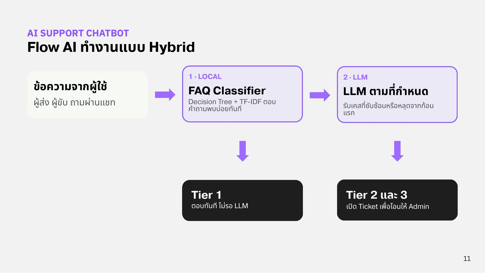

# Overview

AI ของ Lukchang Move คือ **AI Support Chatbot** ที่ทำงานแบบผสมผสาน (Hybrid) เพื่อความรวดเร็วและประหยัดต้นทุนการเรียกใช้ LLM

<figure><figcaption>
Flow AI ทำงานแบบ Hybrid
</figcaption></figure>

## สองชั้นของการทำงาน

1. **Fast Local Classifier (Tier 1):** คำถามที่พบบ่อย (FAQ) ใช้โมเดล Decision Tree + TF-IDF คัดกรองก่อน ตอบได้ทันทีด้วยคำตอบสำเร็จรูป โดยไม่ต้องเสียค่าใช้จ่ายเรียก LLM โมเดลนี้รันบน AWS ภายในบริการ Chat + AI
2. **LLM for Complex Cases (Tier 2 และ 3):** ถ้าคำถามหลุดจากด่านแรกหรือซับซ้อน ระบบส่งต่อให้ LLM ที่รันบน GPU ใน Private Datacenter โดยใช้ System Prompt ควบคุมพฤติกรรมให้ทำงานตาม [Support Tiers](support-tiers.md)

## ทำไมแยกสองที่

* **Cloud:** โมเดลเล็กที่ต้องตอบได้เสมอ (Tier 1)
* **On-prem:** LLM ที่ใช้ GPU ข้อมูลลูกค้าไม่ออกไปหา model provider ภายนอก

ถ้า GPU 0 หรือ Direct Connect ล่ม ผู้ใช้ยังได้รับความช่วยเหลือ เพราะ Decision Tree รันบน cloud คำถาม Tier 1 จึงยังตอบได้ตามปกติ ส่วนคำถามที่ต้องใช้ LLM จะเปิด ticket ทั่วไปให้ Admin แทน (ยังไม่แยก tier)
