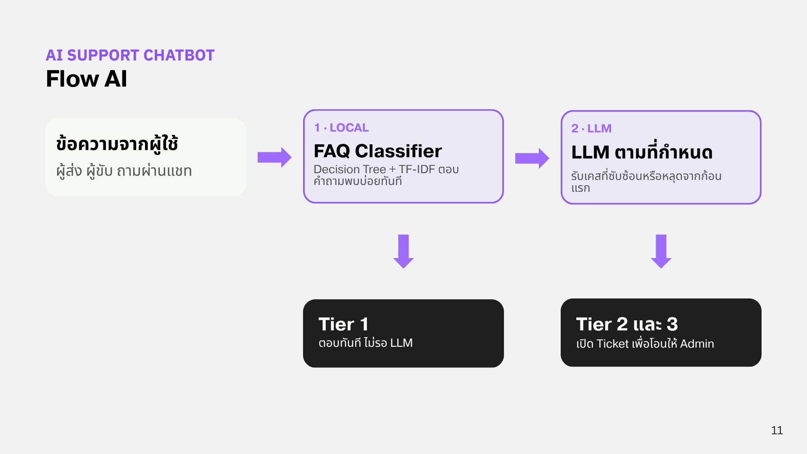

# Support Tiers

AI ตัดสินใจระดับการช่วยเหลือเป็น 4 Tier

| Tier | ชื่อ | การทำงาน |
| --- | --- | --- |
| **1** | Instant Resolve | AI ตอบคำถามพื้นฐานและปิดเคสได้ทันทีด้วยคำตอบสำเร็จรูป (FAQ Classifier ไม่เรียก LLM) |
| **2A** | Auto-Resolve | AI เปิด Ticket ดำเนินการแก้ปัญหาตาม Flow และปิดเคสให้เองอัตโนมัติ |
| **2B** | Admin Review | AI รวบรวมข้อมูล เปิด Ticket และส่งต่อให้ Admin ตรวจสอบตามระยะเวลา SLA |
| **3** | Immediate Escalation (โอนตามหัวข้อ / Topic-Based) | โอนให้เจ้าหน้าที่ (มนุษย์) ทันที เมื่อลูกค้าเลือกหัวข้อที่ละเอียดอ่อน เช่น ความปลอดภัย (Safety), กฎหมาย (Legal) หรือการฉ้อโกง (Fraud) |
| **3-N** | Immediate Escalation (โอนตามพฤติกรรม / Behavior-Based) | AI ตรวจจับสัญญาณระหว่างการสนทนา เช่น อารมณ์เชิงลบสูง (Negative Sentiment), ถามคำถามเดิมซ้ำ, พิมพ์คำสั่งนอกขอบเขต หรือพิมพ์ว่า "ขอคุยกับคน" แล้วโอนให้ Admin ทันที |

## Flow การตัดสินใจ

<figure><figcaption>
Flow AI ของ Support Chatbot
</figcaption></figure>

1. **ข้อความจากผู้ใช้:** ผู้ส่งหรือผู้ขับพิมพ์คำถามผ่านแชทในแอป
2. **ด่านที่ 1 · FAQ Classifier (Local):** โมเดล Decision Tree + TF-IDF ตรวจว่าเป็นคำถามพบบ่อยหรือไม่ ถ้ามั่นใจ จะตอบเป็น **Tier 1** ทันที ไม่ต้องรอ LLM
3. **ด่านที่ 2 · LLM ตามที่กำหนด:** คำถามที่ซับซ้อนหรือหลุดจากด่านแรก จะส่งต่อให้ LLM ช่วยวิเคราะห์ปัญหา
4. **Tier 2 และ 3:** ถ้าต้องให้คนช่วย LLM จะเปิด Ticket แล้วโอนให้ Admin ดูแลต่อตามระดับความเร่งด่วน
