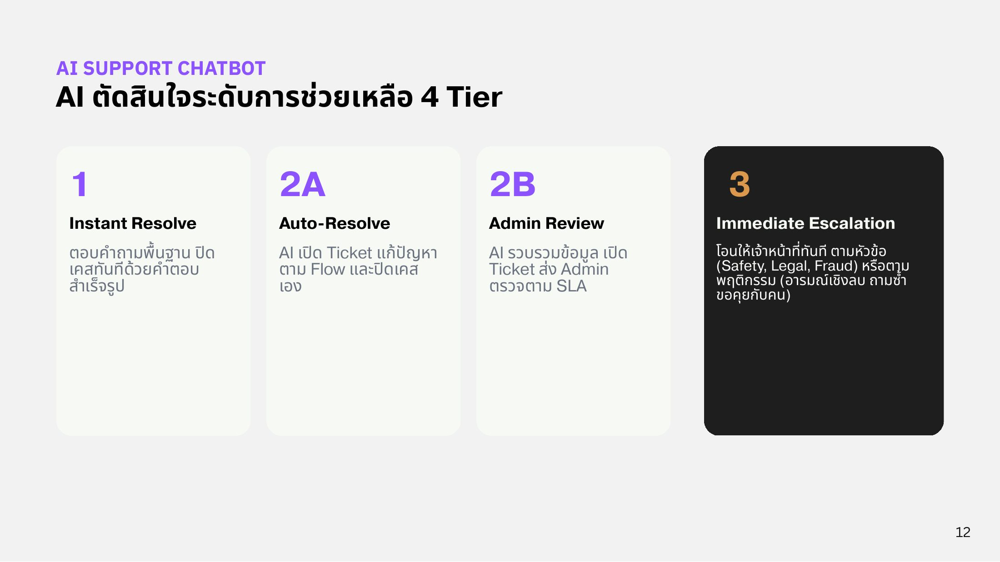
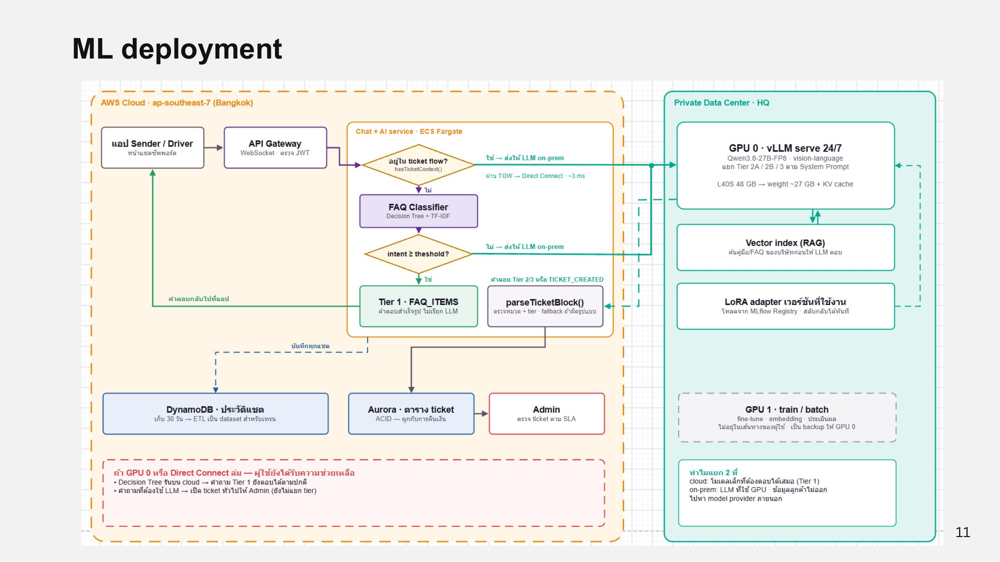

# Support Tiers

AI ตัดสินใจระดับการช่วยเหลือเป็น 4 Tier

<figure><figcaption>
AI ตัดสินใจระดับการช่วยเหลือ 4 Tier
</figcaption></figure>

| Tier | ชื่อ | การทำงาน |
| --- | --- | --- |
| **1** | Instant Resolve | AI ตอบคำถามพื้นฐานและปิดเคสได้ทันทีด้วยคำตอบสำเร็จรูป (FAQ Classifier ไม่เรียก LLM) |
| **2A** | Auto-Resolve | AI เปิด Ticket ดำเนินการแก้ปัญหาตาม Flow และปิดเคสให้เองอัตโนมัติ |
| **2B** | Admin Review | AI รวบรวมข้อมูล เปิด Ticket และส่งต่อให้ Admin ตรวจสอบตามระยะเวลา SLA |
| **3** | Immediate Escalation | โอนให้เจ้าหน้าที่ (มนุษย์) ทันที |

## Tier 3 มี 2 กรณี

* **โอนตามหัวข้อ (Topic-Based):** ลูกค้าเลือกหัวข้อที่ละเอียดอ่อน เช่น ความปลอดภัย (Safety), กฎหมาย (Legal) หรือการฉ้อโกง (Fraud)
* **โอนตามพฤติกรรม (Behavior-Based / 3-N):** AI ตรวจจับสัญญาณระหว่างการสนทนา เช่น อารมณ์เชิงลบสูง (Negative Sentiment), ถามคำถามเดิมซ้ำ, พิมพ์คำสั่งนอกขอบเขต หรือพิมพ์ว่า "ขอคุยกับคน" ระบบจะโอนให้ Admin ทันที

## Flow การตัดสินใจ

<figure><figcaption>
ML deployment: flow ของ Chat + AI service
</figcaption></figure>

1. ข้อความจากแอปผ่าน API Gateway (WebSocket, ตรวจ JWT) เข้าบริการ Chat + AI บน ECS Fargate
2. ถ้าอยู่ใน ticket flow อยู่แล้ว (`hasTicketContext()`) ส่งให้ LLM on-prem ทันที
3. ถ้าไม่ใช่ ส่งเข้า FAQ Classifier แล้วเช็กว่าความมั่นใจของ intent ≥ threshold หรือไม่
4. ถ้ามั่นใจ ตอบด้วย Tier 1 (`FAQ_ITEMS`) ทันที
5. ถ้าไม่มั่นใจ ส่งให้ LLM on-prem ผ่าน Transit Gateway → Direct Connect (~3 ms)
6. คำตอบ Tier 2/3 หรือ `TICKET_CREATED` ผ่าน `parseTicketBlock()` ซึ่งตรวจหมวด + tier และมี fallback ถ้าผิดรูปแบบ
7. ticket บันทึกใน Aurora (ACID เพราะผูกกับการคืนเงิน) แล้ว Admin ตรวจตาม SLA
8. แชททุกข้อความบันทึกใน DynamoDB 30 วัน แล้ว ETL เป็น dataset สำหรับเทรน
