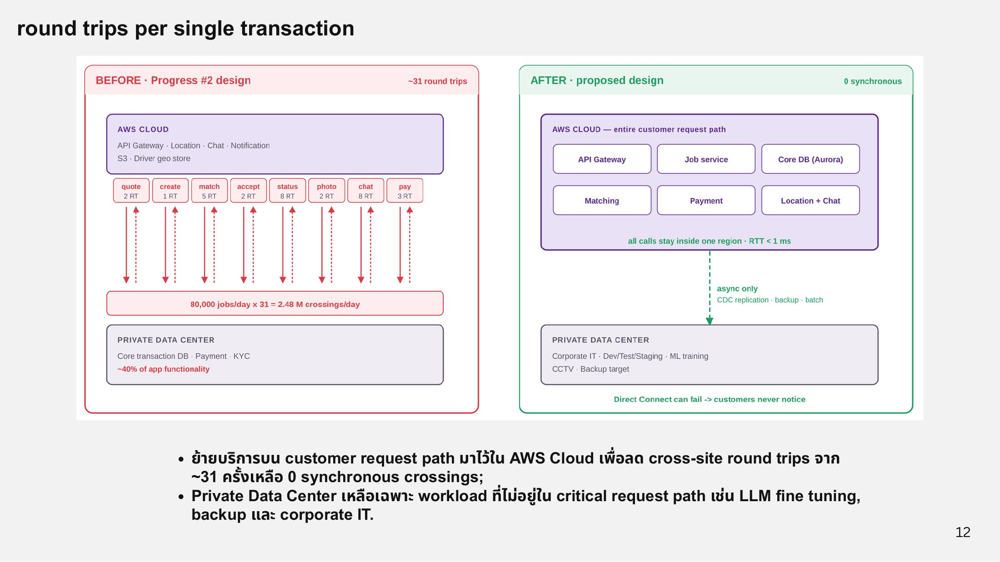
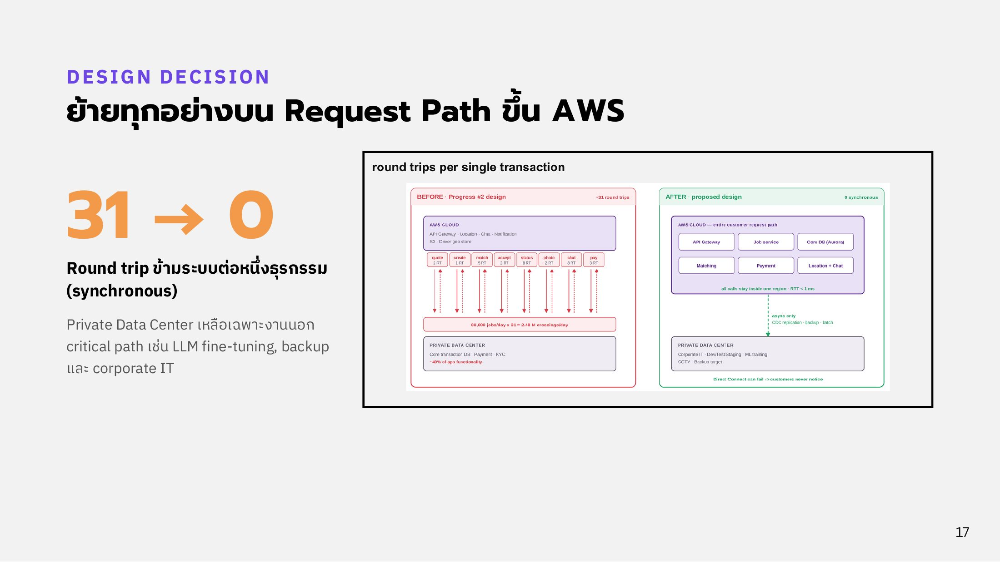

# Design Decision

**ย้ายทุกอย่างบน customer request path ขึ้น AWS ทำให้ round trip ข้ามระบบแบบ synchronous ต่อหนึ่งธุรกรรมลดจากประมาณ 31 ครั้งเหลือ 0**

<figure><figcaption>
Round trips per single transaction: ก่อนและหลัง
</figcaption></figure>

## ก่อน (Progress 2)

Core transaction DB, Payment และ KYC อยู่ใน Private Data Center (~40% ของฟังก์ชันแอป) ขณะที่ API Gateway, Location, Chat และ Notification อยู่บน AWS ทำให้ทุกขั้นของงานต้องข้ามระหว่าง cloud กับ on-prem

| ขั้น | quote | create | match | accept | status | photo | chat | pay | รวม |
| --- | --- | --- | --- | --- | --- | --- | --- | --- | --- |
| Round trips | 2 | 1 | 5 | 2 | 8 | 2 | 8 | 3 | ~31 |

80,000 งาน/วัน × 31 = **2.48 ล้านครั้งต่อวัน** ที่ต้องข้ามเครือข่าย ถ้า Direct Connect มีปัญหา ลูกค้าได้รับผลกระทบทันที

## หลัง (ออกแบบใหม่)

API Gateway, Job service, Core DB (Aurora), Matching, Payment และ Location + Chat อยู่ใน AWS Region เดียวทั้งหมด (RTT < 1 ms) Private Data Center เชื่อมแบบ async เท่านั้น (CDC replication, backup, batch) และเหลือเฉพาะงานนอก critical path ได้แก่ Corporate IT, Dev/Test/Staging, ML training, LLM serving, CCTV และ backup target

ผลคือ **ถ้า Direct Connect ล่ม ลูกค้าไม่รู้สึก** ส่วนคำถามที่ต้องใช้ LLM จะเปิด ticket ให้ Admin แทน

<figure><figcaption>
Design Decision: 31 → 0
</figcaption></figure>

## เหตุผลที่ไม่รัน production ใน Private Datacenter

ห้อง Datacenter ยังไม่ผ่านมาตรฐาน TIA-942 Rated-3 (สายป้อนไฟเส้นเดียว, generator ไม่มี N+1, CRAC ไม่ได้ต่อผ่าน UPS) ดูรายละเอียดที่ [Electrical System](../datacenter/electrical.md)
