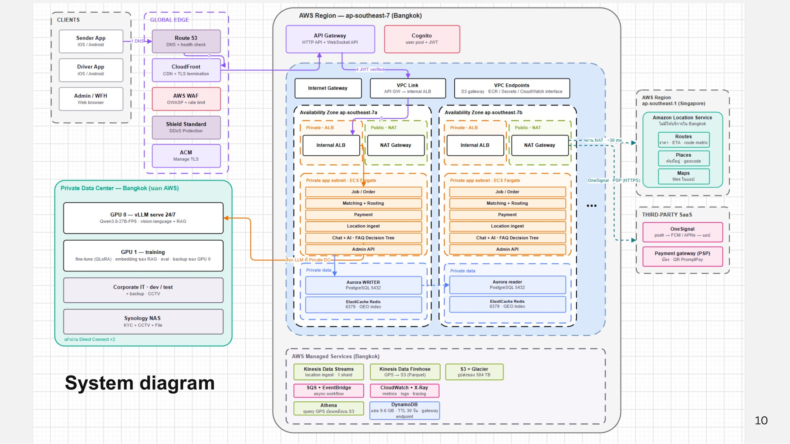
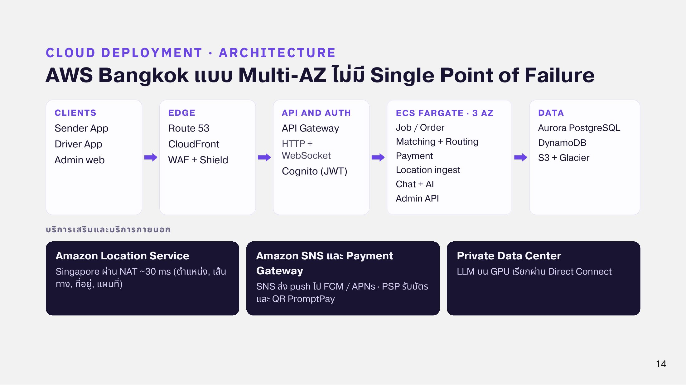

# System Diagram

ระบบ production ทั้งหมดบน customer request path รันบน **AWS Region ap-southeast-7 (Bangkok)** แบบ Multi-AZ จำนวน 3 Availability Zone เพื่อไม่ให้มี Single Point of Failure

<figure><figcaption>
System Diagram
</figcaption></figure>


ภาพ diagram นี้มาจาก Progress 4 ซึ่งยังวาด 2 AZ และ OneSignal ส่วนการออกแบบสุดท้ายที่ทีมยืนยันคือ **3 AZ** และใช้ **Amazon SNS** ส่ง push notification


## สรุปสถาปัตยกรรม

<figure><figcaption>
Cloud Deployment · Architecture
</figcaption></figure>

| ชั้น | บริการ |
| --- | --- |
| Clients | Sender App, Driver App (iOS / Android), Admin / WFH (Web browser) |
| Global Edge | Route 53 (DNS + health check), CloudFront (CDN + TLS), AWS WAF (OWASP + rate limit), Shield Standard (DDoS), ACM (จัดการ TLS) |
| API & Auth | API Gateway (HTTP + WebSocket), Cognito (user pool + JWT) |
| Network | VPC, Internet Gateway, VPC Link, Internal ALB, NAT Gateway, VPC Endpoints (S3 gateway, ECR, Secrets, CloudWatch interface) |
| Compute | ECS Fargate ใน private app subnet ทุก AZ: Job/Order, Matching + Routing, Payment, Location ingest, Chat + AI (FAQ Decision Tree), Admin API |
| Data | Aurora PostgreSQL (writer + reader), ElastiCache Redis (GEO index) |
| Managed services | Kinesis Data Streams (1 shard), Kinesis Data Firehose, S3 + Glacier, SQS + EventBridge, CloudWatch + X-Ray, Athena, DynamoDB |
| นอก Region | Amazon Location Service (ap-southeast-1 Singapore ผ่าน NAT ~30 ms เพราะยังไม่มีใน Bangkok): Routes, Places, Maps |
| Third-party | Amazon SNS → FCM / APNs (push), Payment Gateway (บัตร, QR PromptPay) |
| Hybrid | Private Data Center กรุงเทพฯ เชื่อมผ่าน Direct Connect ×2 (Transit Gateway + Direct Connect Gateway) |

## Private Data Center

| เครื่อง | หน้าที่ |
| --- | --- |
| GPU 0 | vLLM serve Qwen3.8-27B-FP8 ตลอด 24 ชม. + RAG |
| GPU 1 | fine-tune (QLoRA), embedding ของ RAG, evaluation และเป็น backup ของ GPU 0 |
| Corporate IT | dev / test, backup, CCTV |
| Synology NAS | KYC, CCTV, File |
