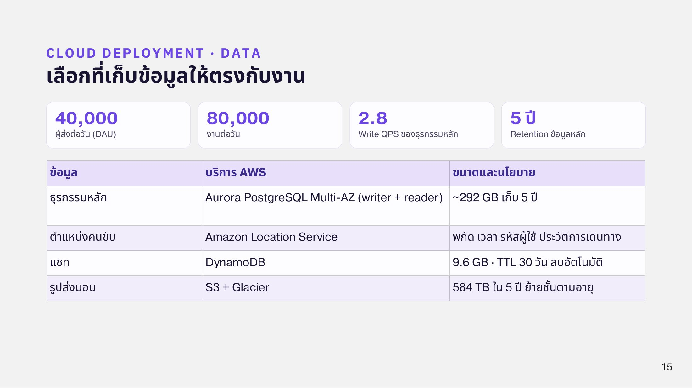
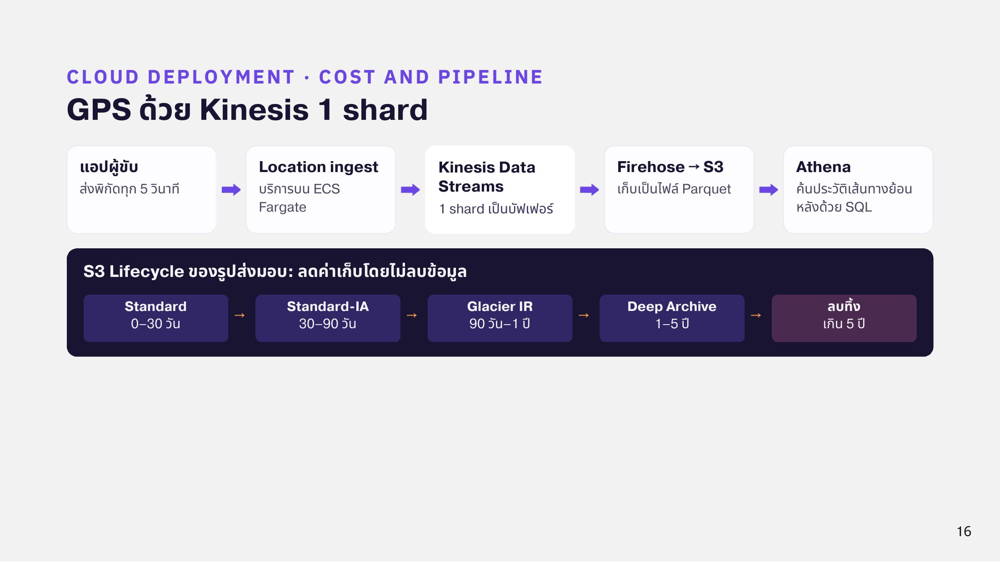

# Capacity & QPS

ตัวเลขที่ใช้ออกแบบระบบ

| รายการ | ค่า |
| --- | --- |
| ผู้ส่งต่อวัน (DAU) | 40,000 คน |
| งานต่อวัน | 80,000 งาน |
| Write QPS ของธุรกรรมหลัก | 2.8 |
| คนขับที่กำลังวิ่งงานพร้อมกัน | 4,000 คน |
| ความถี่ส่งพิกัด | ทุก 5 วินาที |
| GPS write | 4,000 ÷ 5 = **800 ครั้งต่อวินาที** |
| Retention ข้อมูลหลัก | 5 ปี |

<figure><figcaption>
ตัวเลขหลักและที่เก็บข้อมูลบน Cloud
</figcaption></figure>

## ทำไม GPS ไม่เขียนลงฐานข้อมูลหลัก

ถ้าเขียนทุก ping ลง Aurora จะมีการเขียน 800 ครั้งต่อวินาทีตลอดวัน ทั้งที่ข้อมูลส่วนใหญ่ใช้ดูย้อนหลังเท่านั้น ทีมจึงส่ง GPS ผ่านท่อแยก

**แอปผู้ขับ → Location ingest (ECS) → Kinesis Data Streams → Firehose → S3 (Parquet) → Athena**

Kinesis 1 shard รับเขียนได้สูงสุดประมาณ 1,000 records ต่อวินาทีหรือ 1 MB ต่อวินาที พิกัดหนึ่งครั้งมีขนาดประมาณ 100 byte รวมประมาณ 80 KB ต่อวินาที จึงใช้ 1 shard ได้ ถ้าชั่วโมงเร่งด่วนเกิน 1,000 ต่อวินาทีสามารถเพิ่ม shard ได้

<figure><figcaption>
GPS pipeline และ S3 Lifecycle
</figcaption></figure>
