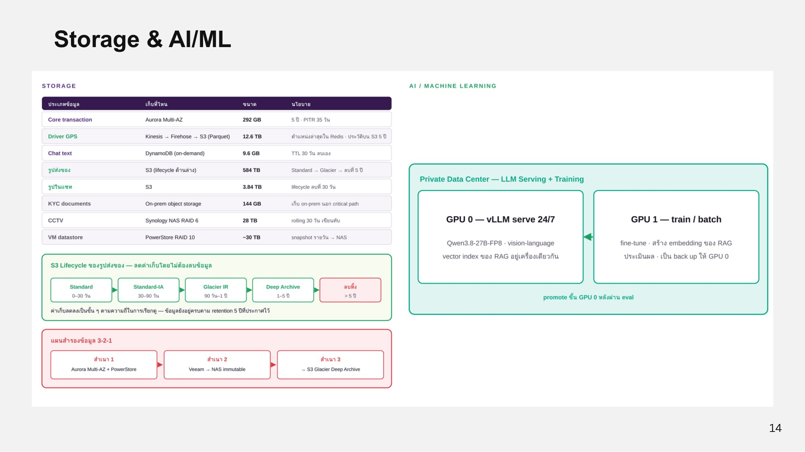

# Data Storage

ทีมเลือกที่เก็บข้อมูลให้ตรงกับลักษณะของข้อมูลแต่ละประเภท

<figure><figcaption>
Storage และ AI/ML
</figcaption></figure>

| ประเภทข้อมูล | เก็บที่ไหน | ขนาด | นโยบาย |
| --- | --- | --- | --- |
| Core transaction | Aurora PostgreSQL Multi-AZ (writer + reader) | 292 GB | เก็บ 5 ปี · PITR 35 วัน |
| Driver GPS | Kinesis → Firehose → S3 (Parquet) | 12.6 TB | ประวัติบน S3 5 ปี |
| ตำแหน่ง/เส้นทาง | Amazon Location Service | - | พิกัด เวลา รหัสผู้ใช้ ประวัติการเดินทาง |
| Chat text | DynamoDB (on-demand) | 9.6 GB | TTL 30 วัน ลบอัตโนมัติ |
| รูปส่งของ | S3 + Glacier (lifecycle) | 584 TB ใน 5 ปี | Standard → Glacier → ลบที่ 5 ปี |
| รูปในแชท | S3 | 3.84 TB | lifecycle ลบที่ 30 วัน |
| KYC documents | On-prem (Synology NAS) | 144 GB | เก็บ on-prem นอก critical path |
| CCTV | Synology NAS RAID 6 | 28 TB | rolling 30 วัน เขียนทับ |
| VM datastore | Dell PowerStore 500T | ~30 TB | snapshot รายวัน → NAS |

## S3 Lifecycle ของรูปส่งของ

ลดค่าเก็บเป็นขั้นตามความถี่ในการเรียกดู โดยข้อมูลยังอยู่ครบตาม retention 5 ปี

| ช่วงอายุ | Storage class |
| --- | --- |
| 0–30 วัน | S3 Standard |
| 30–90 วัน | S3 Standard-IA |
| 90 วัน–1 ปี | S3 Glacier Instant Retrieval |
| 1–5 ปี | S3 Glacier Deep Archive |
| เกิน 5 ปี | ลบทิ้ง |

## แผนสำรองข้อมูล 3-2-1

| สำเนา | ที่เก็บ |
| --- | --- |
| สำเนา 1 | Aurora Multi-AZ + PowerStore |
| สำเนา 2 | Veeam → Synology NAS (immutable snapshot) |
| สำเนา 3 | S3 Glacier Deep Archive |


**[เติม]** ER Diagram ของฐานข้อมูล Aurora (ตารางหลัก เช่น users, jobs, payments, tickets)

