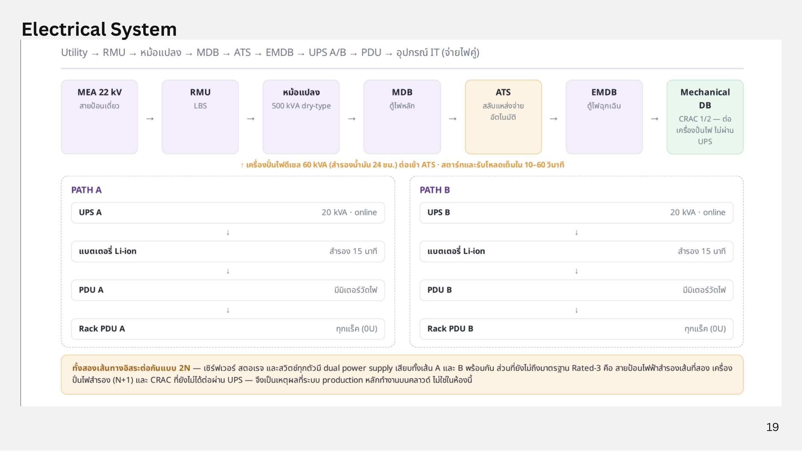
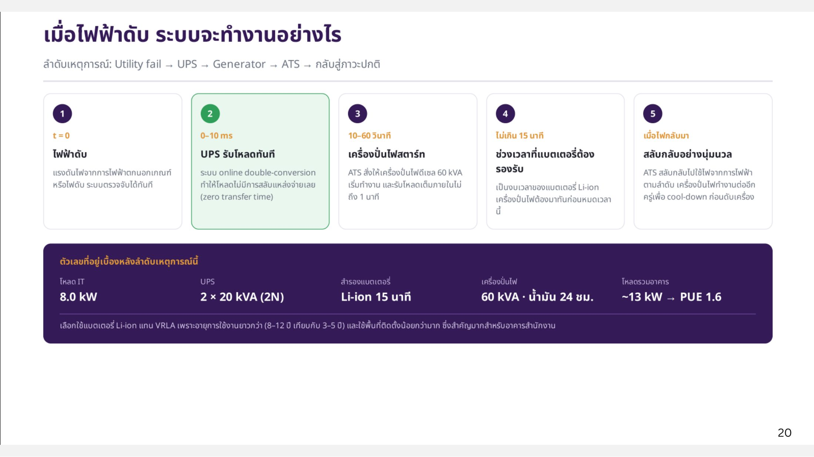

# Electrical System

เส้นทางไฟฟ้า: **Utility → RMU → หม้อแปลง → MDB → ATS → EMDB → UPS A/B → PDU → อุปกรณ์ IT (จ่ายไฟคู่)**

<figure><figcaption>
Electrical System
</figcaption></figure>

| อุปกรณ์ | รายละเอียด |
| --- | --- |
| MEA 22 kV | สายป้อนเดี่ยว |
| RMU | LBS |
| หม้อแปลง | 500 kVA dry-type |
| MDB | ตู้ไฟหลัก |
| ATS | สลับแหล่งจ่ายอัตโนมัติ |
| Diesel generator | 60 kVA สำรองน้ำมัน 24 ชม. ต่อเข้า ATS สตาร์ทและรับโหลดเต็มใน 10–60 วินาที |
| EMDB | ตู้ไฟฉุกเฉิน |
| Mechanical DB | CRAC 1/2 ต่อเครื่องปั่นไฟ ไม่ผ่าน UPS |
| Path A / Path B | UPS 20 kVA online → แบตเตอรี่ Li-ion สำรอง 15 นาที → PDU (มีมิเตอร์) → Rack PDU (0U ทุกแร็ค) |

ทั้งสองเส้นทางอิสระต่อกันแบบ **2N** เซิร์ฟเวอร์ สตอเรจ และสวิตช์ทุกตัวมี dual power supply เสียบทั้งเส้น A และ B พร้อมกัน

## เมื่อไฟฟ้าดับ

<figure><figcaption>
ลำดับเหตุการณ์เมื่อไฟฟ้าดับ
</figcaption></figure>

| ลำดับ | เวลา | เหตุการณ์ |
| --- | --- | --- |
| 1 | t = 0 | ไฟฟ้าดับหรือแรงดันตกนอกเกณฑ์ ระบบตรวจจับได้ทันที |
| 2 | 0–10 ms | UPS รับโหลดทันที ระบบ online double-conversion ทำให้ไม่มีการสลับแหล่งจ่าย (zero transfer time) |
| 3 | 10–60 วินาที | ATS สั่งเครื่องปั่นไฟดีเซล 60 kVA เริ่มทำงาน และรับโหลดเต็มภายในไม่ถึง 1 นาที |
| 4 | ไม่เกิน 15 นาที | งบเวลาของแบตเตอรี่ Li-ion เครื่องปั่นไฟต้องมาทันก่อนหมดเวลานี้ |
| 5 | เมื่อไฟกลับมา | ATS สลับกลับไปใช้ไฟการไฟฟ้าตามลำดับ เครื่องปั่นไฟทำงานต่ออีกครู่เพื่อ cool-down |

| ตัวเลข | ค่า |
| --- | --- |
| โหลด IT | 8.0 kW |
| UPS | 2 × 20 kVA (2N) |
| สำรองแบตเตอรี่ | Li-ion 15 นาที |
| เครื่องปั่นไฟ | 60 kVA · น้ำมัน 24 ชม. |
| โหลดรวมอาคาร | ~13 kW → PUE 1.6 |

เลือกแบตเตอรี่ Li-ion แทน VRLA เพราะอายุการใช้งานยาวกว่า (8–12 ปี เทียบกับ 3–5 ปี) และใช้พื้นที่ติดตั้งน้อยกว่ามาก ซึ่งสำคัญสำหรับอาคารสำนักงาน

## ช่องว่างจากมาตรฐาน TIA-942 Rated-3

ทีมระบุไว้ตรงๆ ว่ายังขาด สายป้อนไฟฟ้าสำรองเส้นที่สอง, เครื่องปั่นไฟสำรอง (N+1), CRAC ที่ต่อผ่าน UPS (continuous cooling) และ dual cooling distribution path นี่คือเหตุผลที่ระบบ production หลักทำงานบน cloud ไม่ใช่ในห้องนี้
