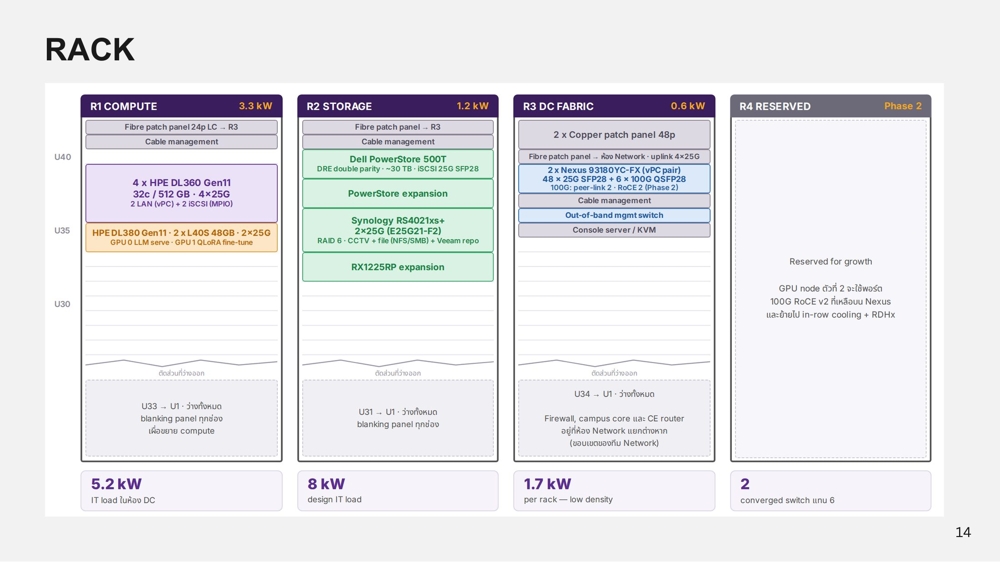

# Rack Design

Private Datacenter อยู่ที่ชั้น 2 ของสำนักงานใหญ่ ใช้ rack 42U ขนาด 800×1200 mm จำนวน 4 ตู้ (ใช้งาน 3 + สำรอง 1)

<figure><figcaption>
Rack layout
</figcaption></figure>

| Rack | โหลด | อุปกรณ์ |
| --- | --- | --- |
| **R1 Compute** | 3.3 kW | Fibre patch panel 24p LC → R3, Cable management, 4 × HPE DL360 Gen11 (32c / 512 GB · 4×25G: 2 LAN (vPC) + 2 iSCSI (MPIO)), HPE DL380 Gen11 · 2 × L40S 48GB · 2×25G (GPU 0 LLM serve · GPU 1 QLoRA fine-tune) · U33 → U1 ว่างไว้ขยาย compute |
| **R2 Storage** | 1.2 kW | Fibre patch panel → R3, Cable management, Dell PowerStore 500T (DRE double parity · ~30 TB · iSCSI 25G SFP28) + expansion, Synology RS4021xs+ 2×25G (RAID 6 · CCTV + file (NFS/SMB) + Veeam repo) + RX1225RP expansion · U31 → U1 ว่าง |
| **R3 DC Fabric** | 0.6 kW | 2 × Copper patch panel 48p, Fibre patch panel → ห้อง Network (uplink 4×25G), 2 × Nexus 93180YC-FX (vPC pair, 48 × 25G SFP28 + 6 × 100G QSFP28; 100G ใช้ peer-link 2 และ RoCE 2 ใน Phase 2), Out-of-band mgmt switch, Console server / KVM |
| **R4 Reserved** | Phase 2 | สำรองสำหรับ GPU node ตัวที่ 2 ซึ่งจะใช้พอร์ต 100G RoCE v2 ที่เหลือบน Nexus และย้ายไปใช้ in-row cooling + RDHx |

| ตัวเลขสรุป | ค่า |
| --- | --- |
| IT load ในห้อง DC | 5.2 kW |
| Design IT load | 8 kW |
| ความหนาแน่นต่อ rack | 1.7 kW (low density) |
| Converged switch | 2 ตัว แทน 6 ตัว |

Firewall, campus core และ CE router อยู่ที่ห้อง Network แยกต่างหาก (ขอบเขตของทีม Network) ช่องว่างทุกช่องปิดด้วย blanking panel
