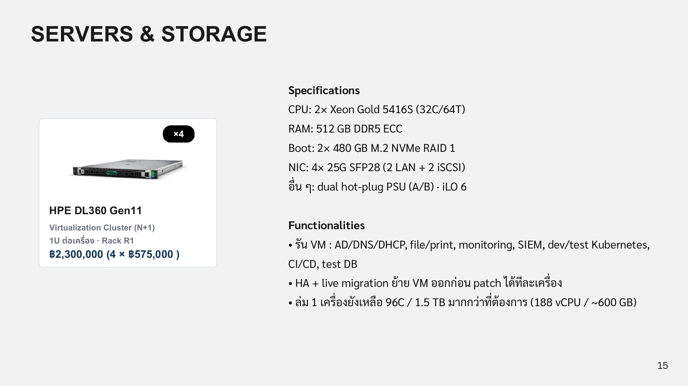
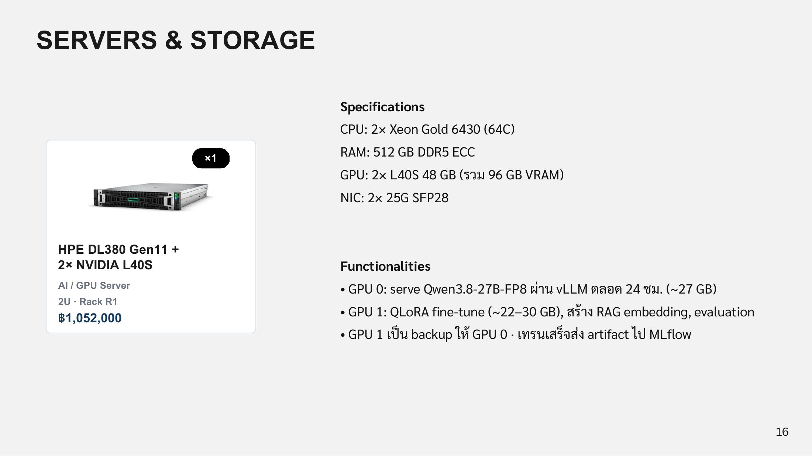
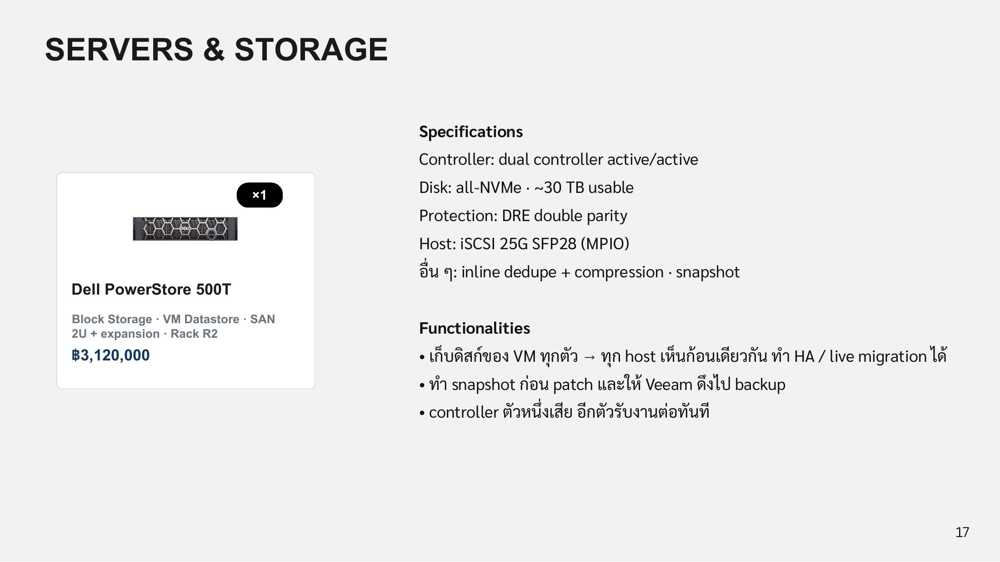
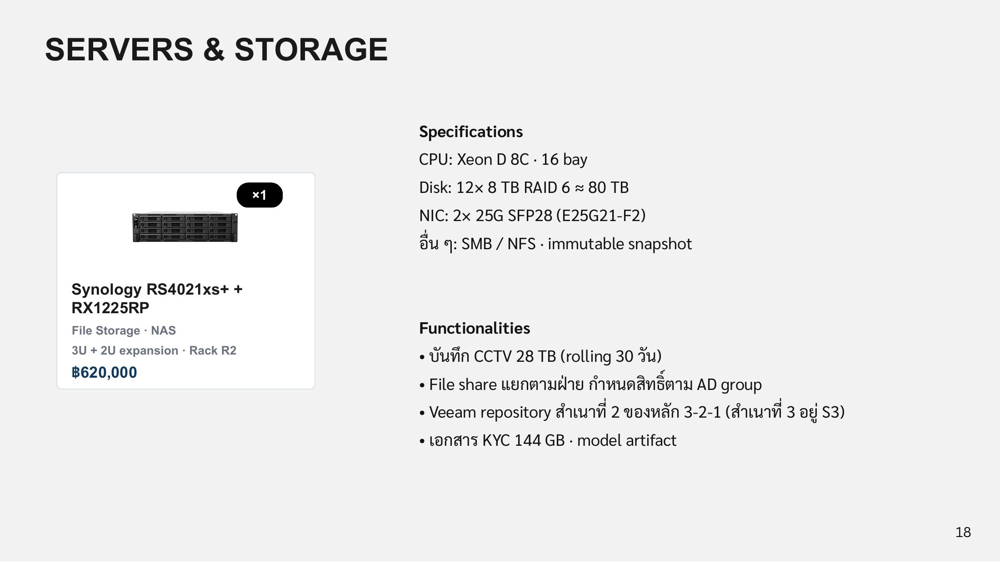

# Server & Storage

## HPE DL360 Gen11 × 4 · Virtualization Cluster (N+1)

<figure><figcaption>
HPE DL360 Gen11
</figcaption></figure>

| Spec | ค่า |
| --- | --- |
| CPU | 2 × Xeon Gold 5416S (32C/64T) |
| RAM | 512 GB DDR5 ECC |
| Boot | 2 × 480 GB M.2 NVMe RAID 1 |
| NIC | 4 × 25G SFP28 (2 LAN + 2 iSCSI) |
| อื่นๆ | dual hot-plug PSU (A/B), iLO 6 |
| ขนาด / ตำแหน่ง | 1U ต่อเครื่อง · Rack R1 |
| ราคา | ฿2,300,000 (4 × ฿575,000) |

* รัน VM: AD/DNS/DHCP, file/print, monitoring, SIEM, dev/test Kubernetes, CI/CD, test DB
* HA + live migration ย้าย VM ออกก่อน patch ได้ทีละเครื่อง
* ถ้าล่ม 1 เครื่อง ยังเหลือ 96C / 1.5 TB มากกว่าที่ต้องการ (188 vCPU / ~600 GB)

## HPE DL380 Gen11 + 2 × NVIDIA L40S · AI / GPU Server

<figure><figcaption>
HPE DL380 Gen11 + 2× NVIDIA L40S
</figcaption></figure>

| Spec | ค่า |
| --- | --- |
| CPU | 2 × Xeon Gold 6430 (64C) |
| RAM | 512 GB DDR5 ECC |
| GPU | 2 × L40S 48 GB (รวม 96 GB VRAM) |
| NIC | 2 × 25G SFP28 |
| ขนาด / ตำแหน่ง | 2U · Rack R1 |
| ราคา | ฿1,052,000 |

* GPU 0: serve Qwen3.8-27B-FP8 ผ่าน vLLM ตลอด 24 ชม. (~27 GB)
* GPU 1: QLoRA fine-tune (~22–30 GB), สร้าง RAG embedding, evaluation
* GPU 1 เป็น backup ให้ GPU 0 เทรนเสร็จส่ง artifact ไป MLflow

## Dell PowerStore 500T · Block Storage (SAN)

<figure><figcaption>
Dell PowerStore 500T
</figcaption></figure>

| Spec | ค่า |
| --- | --- |
| Controller | dual controller active/active |
| Disk | all-NVMe · ~30 TB usable |
| Protection | DRE double parity |
| Host | iSCSI 25G SFP28 (MPIO) |
| อื่นๆ | inline dedupe + compression, snapshot |
| ขนาด / ตำแหน่ง | 2U + expansion · Rack R2 |
| ราคา | ฿3,120,000 |

* เก็บดิสก์ของ VM ทุกตัว ทุก host เห็นก้อนเดียวกัน ทำ HA / live migration ได้
* ทำ snapshot ก่อน patch และให้ Veeam ดึงไป backup
* controller ตัวหนึ่งเสีย อีกตัวรับงานต่อทันที

## Synology RS4021xs+ + RX1225RP · File Storage (NAS)

<figure><figcaption>
Synology RS4021xs+ + RX1225RP
</figcaption></figure>

| Spec | ค่า |
| --- | --- |
| CPU | Xeon D 8C · 16 bay |
| Disk | 12 × 8 TB RAID 6 ≈ 80 TB |
| NIC | 2 × 25G SFP28 (E25G21-F2) |
| อื่นๆ | SMB / NFS, immutable snapshot |
| ขนาด / ตำแหน่ง | 3U + 2U expansion · Rack R2 |
| ราคา | ฿620,000 |

* บันทึก CCTV 28 TB (rolling 30 วัน)
* File share แยกตามฝ่าย กำหนดสิทธิ์ตาม AD group
* Veeam repository สำเนาที่ 2 ของหลัก 3-2-1 (สำเนาที่ 3 อยู่ S3)
* เอกสาร KYC 144 GB และ model artifact
