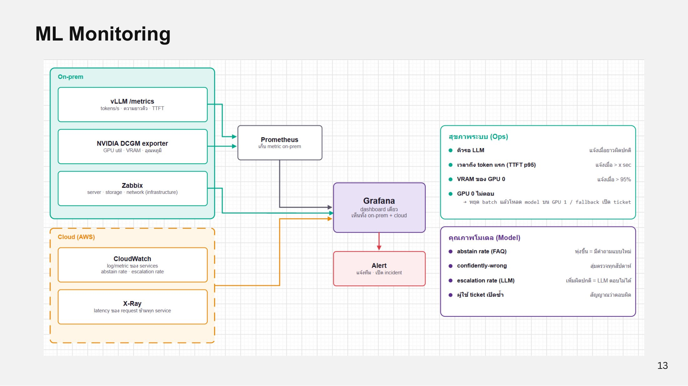

# ML Monitoring

<figure><figcaption>
ML Monitoring
</figcaption></figure>

ทุก metric จากทั้ง on-prem และ cloud รวมไว้ที่ **Grafana** dashboard เดียว และส่ง Alert แจ้งทีมหรือเปิด incident

| แหล่ง | อยู่ที่ | เก็บอะไร |
| --- | --- | --- |
| vLLM /metrics | On-prem → Prometheus | tokens/s, ความยาวคิว, TTFT |
| NVIDIA DCGM exporter | On-prem → Prometheus | GPU util, VRAM, อุณหภูมิ |
| Zabbix | On-prem | server, storage, network (infrastructure) |
| CloudWatch | AWS | log/metric ของ services, abstain rate, escalation rate |
| X-Ray | AWS | latency ของ request ข้ามทุก service |

## สุขภาพระบบ (Ops)

| Metric | แจ้งเตือนเมื่อ |
| --- | --- |
| คิวรอ LLM | ยาวผิดปกติ |
| เวลาถึง token แรก (TTFT p95) | เกินค่าที่กำหนด |
| VRAM ของ GPU 0 | > 95% |
| GPU 0 ไม่ตอบ | หยุด batch แล้วโหลด model บน GPU 1 / fallback เปิด ticket |

## คุณภาพโมเดล (Model)

| Metric | สัญญาณ |
| --- | --- |
| abstain rate (FAQ) | พุ่งขึ้น = มีคำถามแบบใหม่ |
| confidently-wrong | สุ่มตรวจทุกสัปดาห์ |
| escalation rate (LLM) | เพิ่มผิดปกติ = LLM ตอบไม่ได้ |
| ผู้ใช้เปิด ticket ซ้ำ | สัญญาณว่าตอบผิด |
