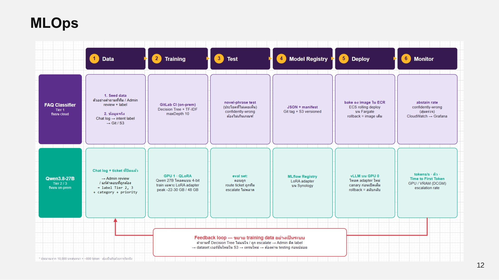

# MLOps Pipeline

<figure><figcaption>
MLOps pipeline ของ FAQ Classifier และ LLM
</figcaption></figure>

| ขั้น | FAQ Classifier (Tier 1, รันบน cloud) | Qwen3.8-27B (Tier 2/3, รันบน on-prem) |
| --- | --- | --- |
| 1. Data | Seed data: ตัวอย่างคำถามที่ทีม/Admin review + label · ข้อมูลจริง: Chat log → intent label → Git / S3 | Chat log + ticket ที่ปิดแล้ว → Admin review / แก้คำตอบที่ถูกต้อง → label Tier 2, 3 + category + priority |
| 2. Training | GitLab CI (on-prem) · Decision Tree + TF-IDF maxDepth 10 | GPU 1 · QLoRA: โหลด Qwen 27B แบบ 4-bit train เฉพาะ LoRA adapter (peak ~22–30 GB / 48 GB) |
| 3. Test | novel-phrase test (ประโยคที่ไม่เคยเห็น) · confidently-wrong ต้องไม่เกินเกณฑ์ | eval set: ตอบถูก, route ticket ถูกทีม, escalate ไม่พลาด |
| 4. Model Registry | JSON + manifest · Git tag + S3 versioned | MLflow Registry · LoRA adapter บน Synology |
| 5. Deploy | bake ลง image ใน ECR · ECS rolling deploy บน Fargate · rollback = image เดิม | vLLM บน GPU 0 โหลด adapter ใหม่ · canary ก่อนเปิดเต็ม · rollback = สลับกลับ |
| 6. Monitor | abstain rate · confidently-wrong (สุ่มตรวจ) · CloudWatch → Grafana | tokens/s · คิว · Time to First Token · GPU / VRAM (DCGM) · escalation rate |

## Feedback loop

คำถามที่ Decision Tree ไม่แน่ใจ หรือถูก escalate จะให้ Admin ติด label แล้วสร้าง dataset เวอร์ชันใหม่ใน S3 นำไปเทรนใหม่ และต้องผ่าน testing ก่อนปล่อยทุกครั้ง ทำให้ training data ขยายอย่างเป็นระบบ

ขนาด dataset ของ LLM ประมาณจาก 10,000 บทสนทนา × ~800 token ซึ่งต้องยืนยันด้วยการวัดจริง
