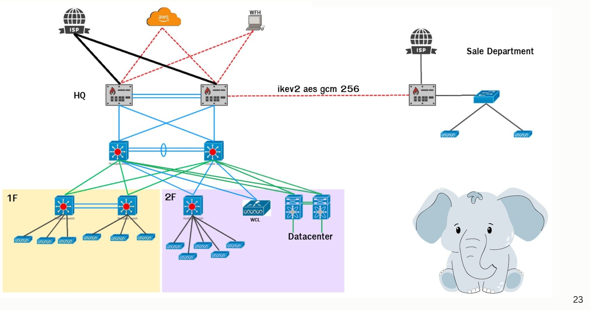

# Logical Topology

<figure><figcaption>
Logical Topology
</figcaption></figure>

* **HQ:** FortiGate 200F × 2 (HA) เชื่อม ISP 2 เส้น ต่อลง Core stack (Catalyst 9300-48P × 2) แบบ cross-connect
* **Core stack** กระจายไปยัง Access switch ชั้น 1 (× 2 stack) และชั้น 2 (× 1) WLAN Controller (Catalyst 9800-L) และ Nexus 93180YC-FX × 2 ใน Datacenter
* **AWS:** เชื่อมจาก HQ ด้วย Direct Connect (และ AWS Client VPN สำหรับ WFH ใน diagram ระบบ)
* **WFH:** เชื่อมเข้า HQ ผ่าน VPN
* **Sale Department:** FortiGate 40F เชื่อม ISP ของตัวเอง และเชื่อมกับ HQ ด้วย IPSec site-to-site (IKEv2, AES-GCM 256)
