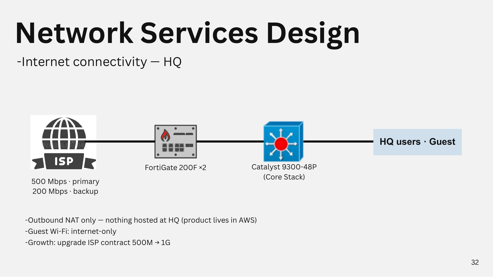
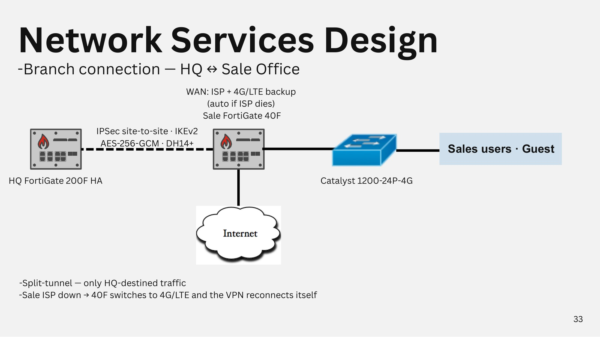
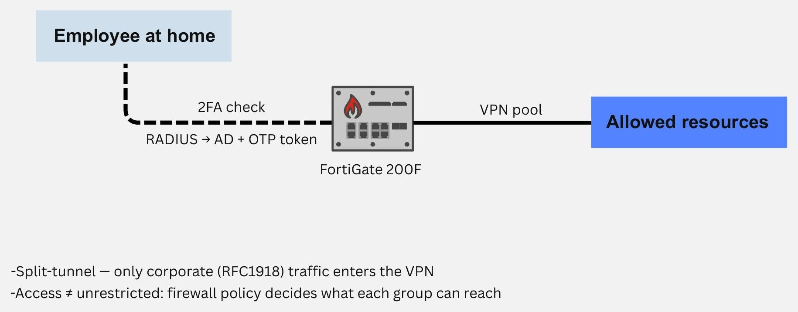

# Network Services

## Internet connectivity (HQ)

<figure><figcaption>
Internet connectivity HQ
</figcaption></figure>

* ISP 2 เส้น: 500 Mbps (primary) และ 200 Mbps (backup) เข้า FortiGate 200F × 2 แล้วลง Core stack
* Outbound NAT เท่านั้น ไม่มีบริการที่ host อยู่ที่ HQ (ตัวผลิตภัณฑ์อยู่บน AWS)
* Guest Wi-Fi ใช้ได้เฉพาะ internet
* แผนเติบโต: อัปเกรด ISP จาก 500M เป็น 1G

## Branch connection (HQ ↔ Sale Office)

<figure><figcaption>
Branch connection HQ ↔ Sale Office
</figcaption></figure>

* IPSec site-to-site · IKEv2 · AES-256-GCM · DH14+ ระหว่าง HQ FortiGate 200F HA กับ Sale FortiGate 40F
* WAN ของสาขาใช้ ISP + 4G/LTE backup ถ้า ISP ล่ม FortiGate 40F จะสลับไป 4G/LTE และ VPN reconnect เอง
* Split-tunnel: ส่งเฉพาะ traffic ที่ไป HQ เข้า VPN

## WFH remote access

<figure><figcaption>
WFH remote access
</figcaption></figure>

* พนักงานที่บ้านเชื่อม VPN เข้า FortiGate 200F โดยผ่าน 2FA (RADIUS → AD + OTP token)
* Split-tunnel: เฉพาะ traffic ของบริษัท (RFC1918) เข้า VPN
* เข้าถึงได้ไม่ใช่ทุกอย่าง firewall policy กำหนดว่าแต่ละกลุ่มเข้าถึงอะไรได้บ้าง
