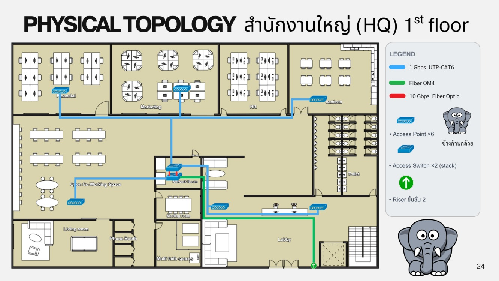
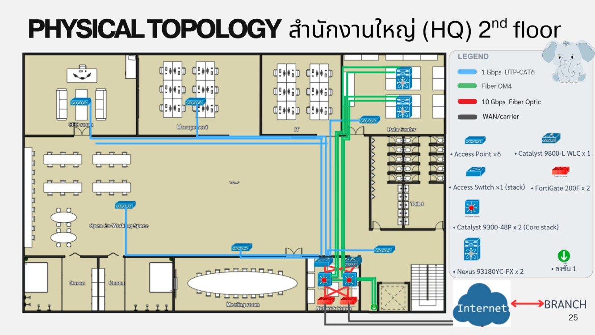
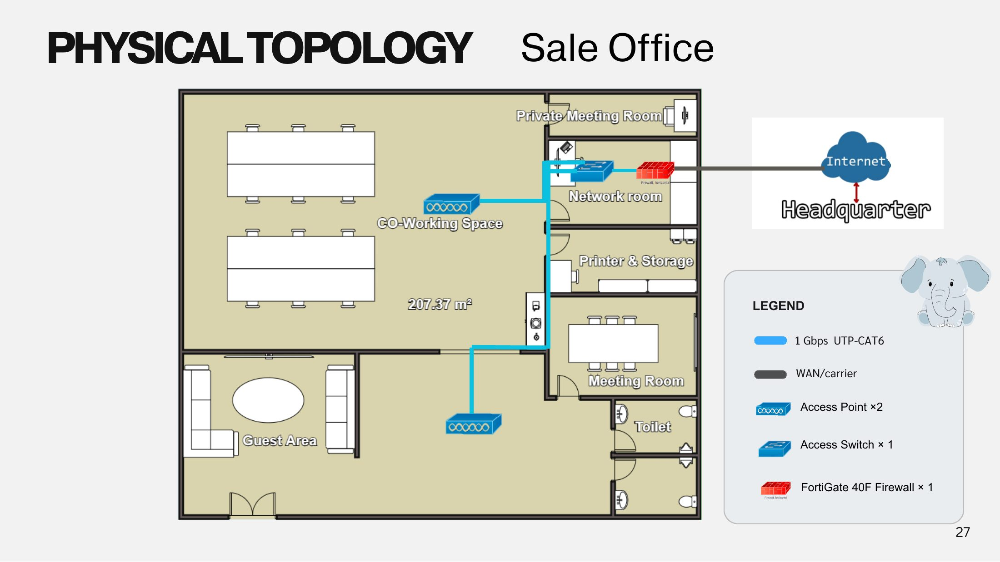

# Physical Topology & Floor Plan

## สำนักงานใหญ่ (HQ) ชั้น 1

<figure><figcaption>
Physical Topology HQ ชั้น 1
</figcaption></figure>

* Access Point × 6 (Financial, Marketing, canteen, Open Co-Working Space, Lobby และอื่นๆ)
* Access Switch × 2 (stack) ใน Network Room
* Riser ขึ้นชั้น 2 ที่ปล่องบันได (Fiber OM4)

## สำนักงานใหญ่ (HQ) ชั้น 2

<figure><figcaption>
Physical Topology HQ ชั้น 2
</figcaption></figure>

* Access Point × 5 และ Catalyst 9800-L WLC × 1
* Access Switch × 1 (stack)
* FortiGate 200F × 2 และ Catalyst 9300-48P × 2 (Core stack) ใน Network Room
* Nexus 93180YC-FX × 2 ในห้อง Data Center
* WAN เชื่อม Internet และ Branch

| สาย | ใช้กับ |
| --- | --- |
| 1 Gbps UTP-CAT6 | AP และอุปกรณ์ปลายทาง |
| Fiber OM4 | riser ระหว่างชั้น และ Core → Datacenter |
| 10 Gbps Fiber Optic | ระหว่าง Core และ Firewall |

## Sale Office

<figure><figcaption>
Physical Topology Sale Office
</figcaption></figure>

* Access Point × 2
* Access Switch × 1
* FortiGate 40F Firewall × 1
