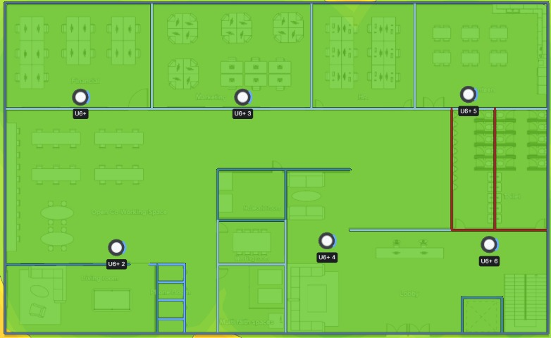
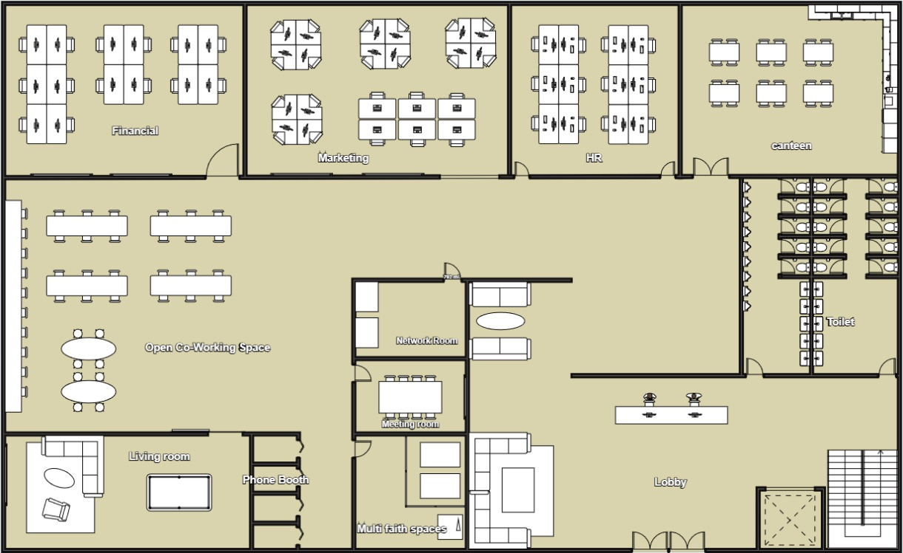
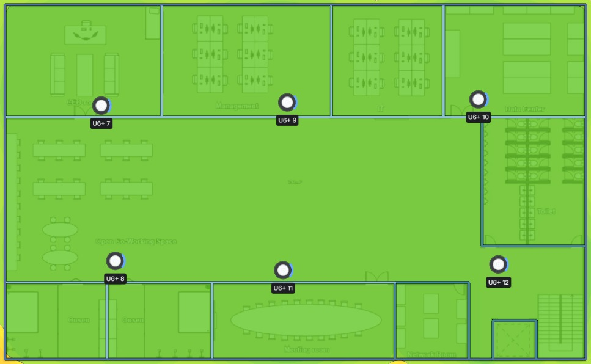
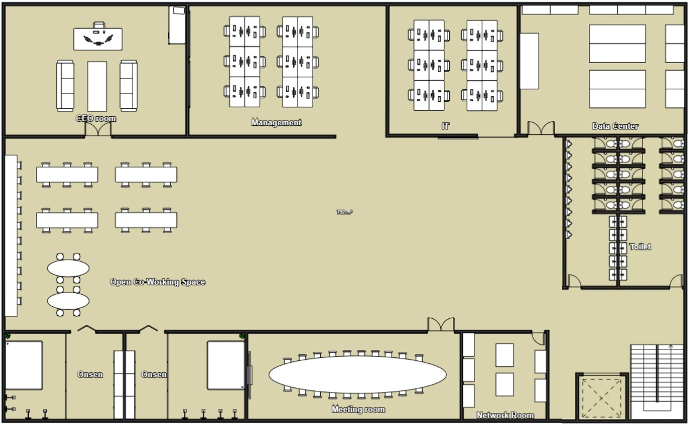
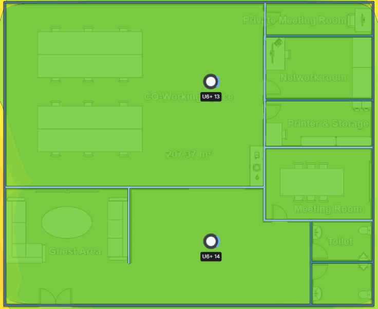
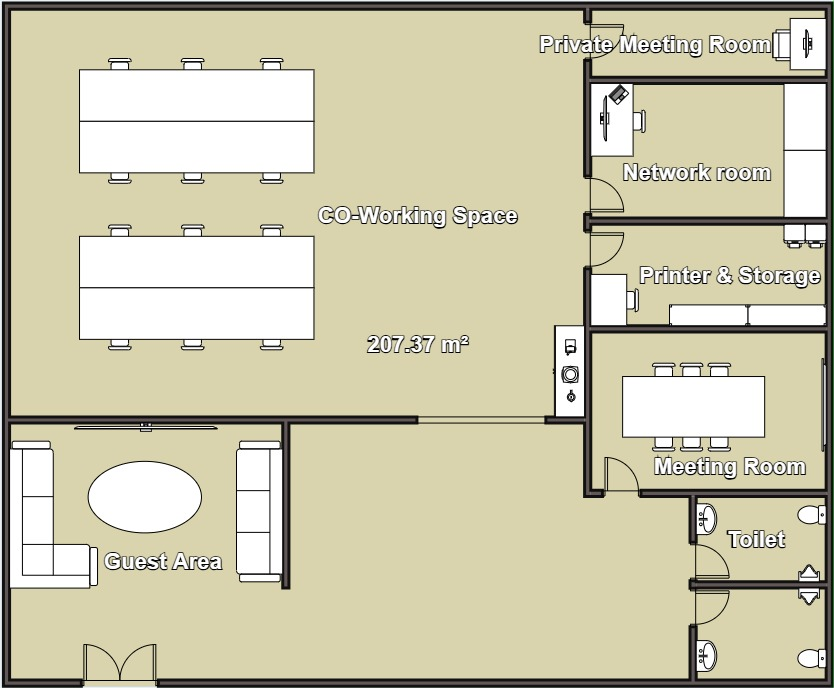

# Physical Topology & Floor Plan

สำนักงานใหญ่ (HQ) มี 2 ชั้น รองรับผู้บริหารและพนักงานประมาณ 60–100 คน ผู้ใช้ระบบได้แก่ ฝ่ายบริหาร ฝ่ายบุคคล ฝ่ายการตลาด ฝ่ายการเงิน ฝ่ายสารสนเทศ และแขกภายนอก ส่วน Sale Office เป็นสาขาขนาดเล็กสำหรับพนักงานขาย 5–10 คน

แต่ละสาขามี 3 มุมมอง ได้แก่ ผังห้อง (Floor Plan), การเดินสายและวางอุปกรณ์ (Physical Topology) และ Wi-Fi Heat Map ที่จำลองความแรงสัญญาณจากตำแหน่ง Access Point จริง พื้นที่สีเขียวคือสัญญาณดี ครอบคลุมทุกห้องที่มีผู้ใช้งาน

## สำนักงานใหญ่ (HQ) ชั้น 1



<figure><figcaption>
Physical Topology HQ ชั้น 1
</figcaption></figure>

* Access Point × 6 ที่ Financial, Marketing, canteen, Open Co-Working Space, ห้องนั่งเล่นข้าง Network Room และ Lobby
* Access Switch × 2 (stack) ใน Network Room
* Riser ขึ้นชั้น 2 ที่ปล่องบันได (Fiber OM4)



<figure><figcaption>
Wi-Fi Heat Map HQ ชั้น 1 (AP 1–6)
</figcaption></figure>

AP 6 ตัวครอบคลุมทั้งชั้น ทั้งโซนห้องทำงานด้านบน Open Co-Working Space, Lobby และโซนห้องน้ำ



<figure><figcaption>
ผังห้อง HQ ชั้น 1
</figcaption></figure>

ห้อง Financial, Marketing, HR, canteen, Open Co-Working Space, Living room, Phone Booth, Network Room, Meeting room, Multi faith spaces, Lobby และห้องน้ำ



## สำนักงานใหญ่ (HQ) ชั้น 2



<figure><figcaption>
Physical Topology HQ ชั้น 2
</figcaption></figure>

* Access Point × 6 ที่ CEO room, Management, หน้า Data Center, Open Co-Working Space, หน้า Meeting room และโถงข้างห้องน้ำ
* Catalyst 9800-L WLC × 1
* Access Switch × 1 (stack)
* FortiGate 200F × 2 และ Catalyst 9300-48P × 2 (Core stack) ใน Network Room
* Nexus 93180YC-FX × 2 ในห้อง Data Center
* WAN เชื่อม Internet และ Branch



<figure><figcaption>
Wi-Fi Heat Map HQ ชั้น 2 (AP 7–12)
</figcaption></figure>

เพิ่ม AP เป็น 6 ตัว (เดิม 5) เพื่อให้สัญญาณครอบคลุมโถง Open Co-Working Space ที่กว้าง รวมถึงห้อง Onsen, Meeting room และ Network Room ด้านล่าง



<figure><figcaption>
ผังห้อง HQ ชั้น 2
</figcaption></figure>

ห้อง CEO room, Management, IT, Data Center, Open Co-Working Space, Onsen, Meeting room, Network Room และห้องน้ำ



| สาย | ใช้กับ |
| --- | --- |
| 1 Gbps UTP-CAT6 | AP และอุปกรณ์ปลายทาง |
| Fiber OM4 | riser ระหว่างชั้น และ Core → Datacenter |
| 10 Gbps Fiber Optic | ระหว่าง Core และ Firewall |

## Sale Office



<figure><figcaption>
Physical Topology Sale Office
</figcaption></figure>

* Access Point × 2 ที่ CO-Working Space และโถงทางเข้า
* Access Switch × 1
* FortiGate 40F Firewall × 1 เชื่อม Internet ไปยัง Headquarter



<figure><figcaption>
Wi-Fi Heat Map Sale Office (AP 13–14)
</figcaption></figure>

AP 2 ตัวครอบคลุมพื้นที่ 207.37 m² ทั้งหมด รวมถึงห้องประชุม ห้อง Printer & Storage และห้องน้ำ



<figure><figcaption>
ผังห้อง Sale Office
</figcaption></figure>

ห้อง CO-Working Space, Guest Area, Private Meeting Room, Network room, Printer & Storage, Meeting Room และห้องน้ำ


