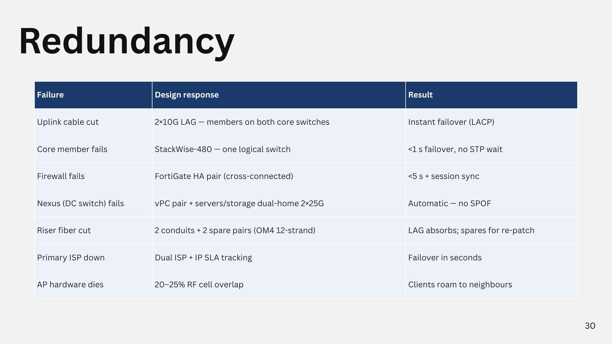

# Redundancy

<figure><figcaption>
Redundancy
</figcaption></figure>

| Failure | Design response | Result |
| --- | --- | --- |
| Uplink cable cut | 2 × 10G LAG members on both core switches | Instant failover (LACP) |
| Core member fails | StackWise-480 (one logical switch) | < 1 s failover, no STP wait |
| Firewall fails | FortiGate HA pair (cross-connected) | < 5 s + session sync |
| Nexus (DC switch) fails | vPC pair + servers/storage dual-home 2 × 25G | Automatic, no SPOF |
| Riser fiber cut | 2 conduits + 2 spare pairs (OM4 12-strand) | LAG absorbs; spares for re-patch |
| Primary ISP down | Dual ISP + IP SLA tracking | Failover in seconds |
| AP hardware dies | 20–25% RF cell overlap | Clients roam to neighbours |
