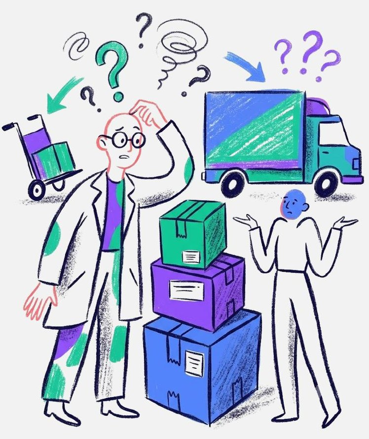

# Problem

การส่งของชิ้นใหญ่หรือของที่ต้องใช้รถเฉพาะทางในปัจจุบันยังมีปัญหา 3 ข้อหลัก

<figure><figcaption>
ปัญหาของการส่งของชิ้นใหญ่ในปัจจุบัน
</figcaption></figure>

## 1. ผู้ส่งไม่รู้ขนาดที่แน่ชัดของพัสดุ

ผู้ส่งมักไม่รู้ขนาดที่แน่ชัดของสิ่งที่ต้องการส่ง จึงยากที่จะเลือกรถให้พอดีกับของ ถ้าเลือกรถเล็กเกินไปก็ขนไม่ได้ ถ้าเลือกใหญ่เกินไปก็เสียค่าใช้จ่ายเกินจำเป็น

## 2. เสี่ยงถูกหลอกเมื่อหาคนขนของผ่านโซเชียลมีเดีย

การโพสต์หาคนขนของผ่านแพลตฟอร์มโซเชียลมีเดียไม่มีการยืนยันตัวตนของผู้รับงาน ผู้ส่งจึงมีความเสี่ยงที่จะถูกหลอก และไม่มีช่องทางติดตามหรือร้องเรียนเมื่อเกิดปัญหา

## 3. สินค้าบางประเภทส่งได้ไม่ทุกคัน

สินค้าแต่ละประเภทมีข้อจำกัดในการขนส่ง ผู้ส่งต้องเลือกรถที่เหมาะกับสินค้านั้นๆ เช่น ของแตกง่ายหรือของที่ต้องใช้รถตู้ทึบ
