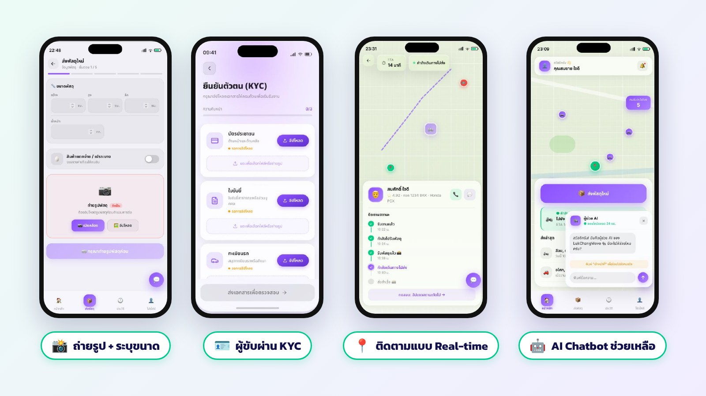

# Solution

Lukchang Move แก้ปัญหาทั้ง 3 ข้อด้วยฟีเจอร์ต่อไปนี้

<figure><figcaption>
ฟีเจอร์ที่แก้ปัญหา: ถ่ายรูปและระบุขนาด, KYC ผู้ขับ, ติดตามแบบ Real-time และ AI Chatbot
</figcaption></figure>

| ปัญหา | โซลูชัน |
| --- | --- |
| ไม่รู้ขนาดพัสดุ | ผู้ส่งถ่ายรูปพัสดุ หรือกรอกขนาด (กว้าง × สูง × ลึก) น้ำหนัก และจำนวนก่อนส่ง ผู้ขับเห็นข้อมูลชัดตั้งแต่ต้น |
| เสี่ยงถูกหลอก | ผู้ขับทุกคนต้องผ่านการตรวจสอบตัวตน (KYC) โดย Admin และติดตามพัสดุได้ตั้งแต่ต้นจนจบ |
| ข้อจำกัดประเภทสินค้า | ระบุประเภทพัสดุ (เช่น สินค้าแตกง่าย/เปราะบาง) เพื่อเลือกรถขนส่งที่เหมาะสมที่สุด |
| เมื่อเกิดปัญหา | AI Support Chatbot ตอบคำถามทันที และส่งต่อให้ Admin เมื่อจำเป็น |

## เทียบกับการหาคนขนของผ่านโซเชียลมีเดีย

| | โพสต์หาในโซเชียลมีเดีย | Lukchang Move |
| --- | --- | --- |
| ตัวตนผู้ขับ | ไม่รู้ว่าเป็นใคร | ผ่าน KYC โดย Admin |
| ข้อมูลพัสดุ | อธิบายด้วยข้อความ | รูปถ่าย ขนาด น้ำหนัก และประเภท |
| การติดตาม | ต้องโทรถาม | ดูตำแหน่งบนแผนที่และ ETA ได้ตลอด |
| การยืนยันส่งมอบ | ไม่มีหลักฐาน | ผู้รับเซ็นชื่อยืนยันในแอป |
| เมื่อมีปัญหา | ต้องจัดการเอง | Chatbot + Admin ดูแลตาม SLA |


ใน Proposal ช่วงแรก ทีมวางแผนให้ AI วิเคราะห์รูปพัสดุเพื่อประเมินปริมาตรและหมวดหมู่ แล้วจับคู่กับประเภทรถอัตโนมัติ ในการพัฒนาจริงทีมเลือกให้ AI หลักเป็น **Support Chatbot** แทน ส่วนรูปพัสดุใช้เพื่อให้ผู้ขับเห็นของจริงก่อนรับงาน

