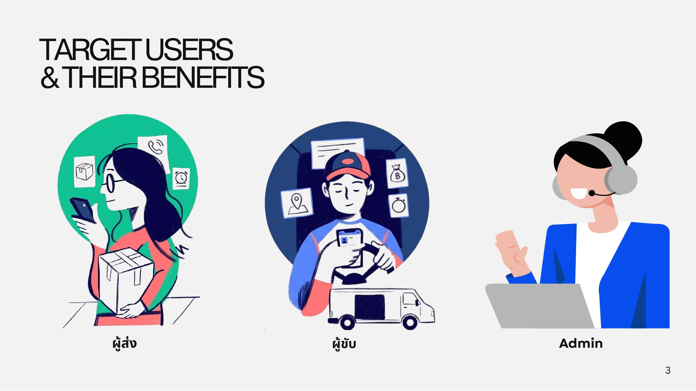

# Target Users

ระบบมีผู้ใช้ 3 กลุ่ม แต่ละกลุ่มได้ประโยชน์ต่างกัน

<figure><figcaption>
กลุ่มผู้ใช้: ผู้ส่ง ผู้ขับ และ Admin
</figcaption></figure>

| กลุ่มผู้ใช้ | ใช้ผ่าน | ได้อะไรจากระบบ |
| --- | --- | --- |
| **ผู้ส่ง (Sender)** | แอปมือถือ iOS / Android | ส่งของง่ายขึ้นและมั่นใจขึ้น ระบุขนาดและประเภทพัสดุได้ชัด จองล่วงหน้าได้ และติดตามสถานะได้ตลอด |
| **ผู้ขับ (Driver)** | แอปมือถือ iOS / Android | ได้งานที่มีข้อมูลพัสดุชัดเจน แชทกับผู้ส่งได้ และดูประวัติงานกับสรุปรายได้ของตัวเอง |
| **Admin** | Web browser (ผ่านเครือข่ายบริษัทหรือ VPN) | ตรวจสอบเอกสาร KYC ของผู้ขับ ดูภาพรวมออเดอร์และรายได้ และจัดการเคสที่ Chatbot ส่งต่อมา |
