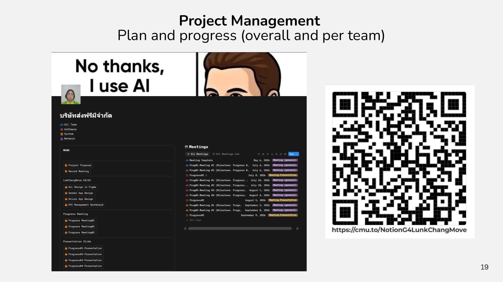
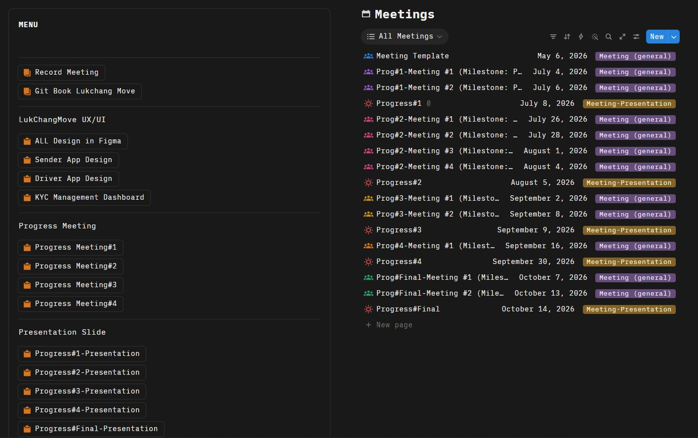
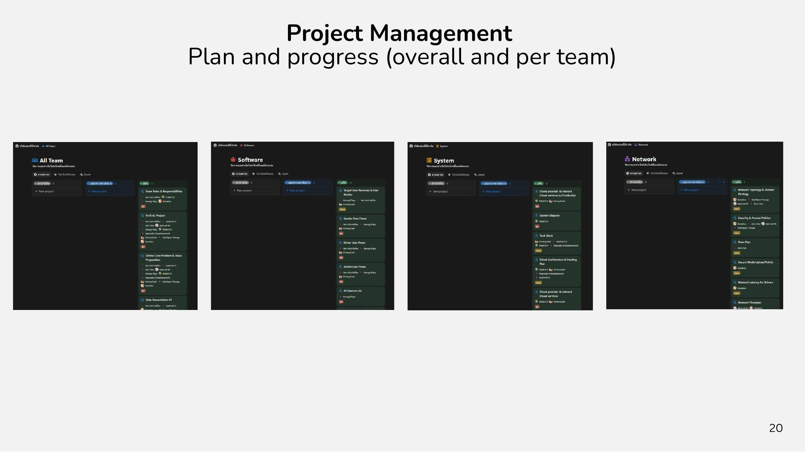
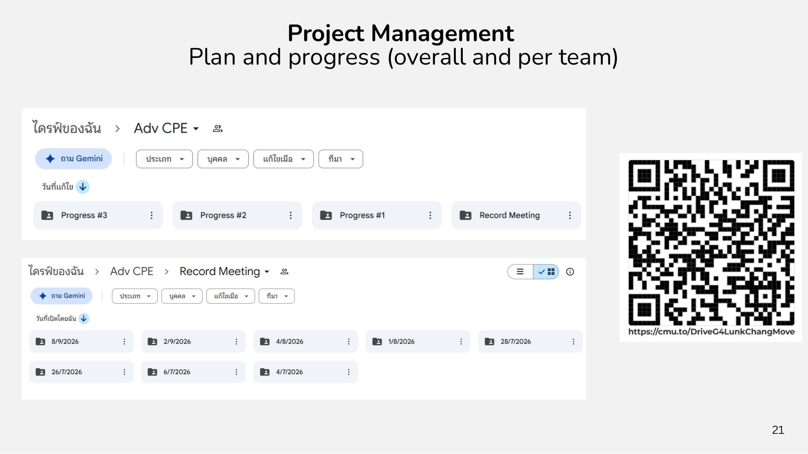

# Project Management

ทีมใช้ **Notion** วางแผนและติดตามงาน แบ่งการทำงานตามฝ่าย (All Team, Software, System, Network) พร้อมระบุผู้รับผิดชอบและกำหนดส่งชัดเจน และใช้ **Google Drive** เก็บไฟล์งานและบันทึกการประชุม

<figure><figcaption>
Notion workspace ของทีม
</figcaption></figure>

* Notion: [cmu.to/NotionG4LunkChangMove](https://cmu.to/NotionG4LunkChangMove)
* Google Drive: [cmu.to/DriveG4LunkChangMove](https://cmu.to/DriveG4LunkChangMove)

## ใน Notion มีอะไรบ้าง

* Record Meeting และลิงก์ไปยัง GitBook Lukchang Move
* LukChangMove UX/UI: All Design in Figma, Sender App Design, Driver App Design, KYC Management Dashboard
* Progress Meeting #1–#4 และ Presentation Slide ของ Progress #1–#4 และ Progress #Final
* ฐานข้อมูล Meetings ที่บันทึกการประชุมทุกครั้ง

<figure><figcaption>
หน้าเมนูและฐานข้อมูล Meetings ใน Notion (ล่าสุด)
</figcaption></figure>

## ไทม์ไลน์การประชุม

| วันที่ | การประชุม |
| --- | --- |
| 4 ก.ค. 2026 | Prog#1 Meeting #1 |
| 6 ก.ค. 2026 | Prog#1 Meeting #2 |
| 8 ก.ค. 2026 | **Progress #1** |
| 26 ก.ค. 2026 | Prog#2 Meeting #1 |
| 28 ก.ค. 2026 | Prog#2 Meeting #2 |
| 1 ส.ค. 2026 | Prog#2 Meeting #3 |
| 4 ส.ค. 2026 | Prog#2 Meeting #4 |
| 5 ส.ค. 2026 | **Progress #2** |
| 2 ก.ย. 2026 | Prog#3 Meeting #1 |
| 8 ก.ย. 2026 | Prog#3 Meeting #2 |
| 9 ก.ย. 2026 | **Progress #3** |
| 16 ก.ย. 2026 | Prog#4 Meeting #1 |
| 30 ก.ย. 2026 | **Progress #4** |
| 7 ต.ค. 2026 | Prog#Final Meeting #1 |
| 13 ต.ค. 2026 | Prog#Final Meeting #2 |
| 14 ต.ค. 2026 | **Progress #Final** |

## บอร์ดงานแต่ละทีม

<figure><figcaption>
บอร์ดงานของ All Team, Software, System และ Network
</figcaption></figure>

<figure><figcaption>
Google Drive ของทีม
</figcaption></figure>
