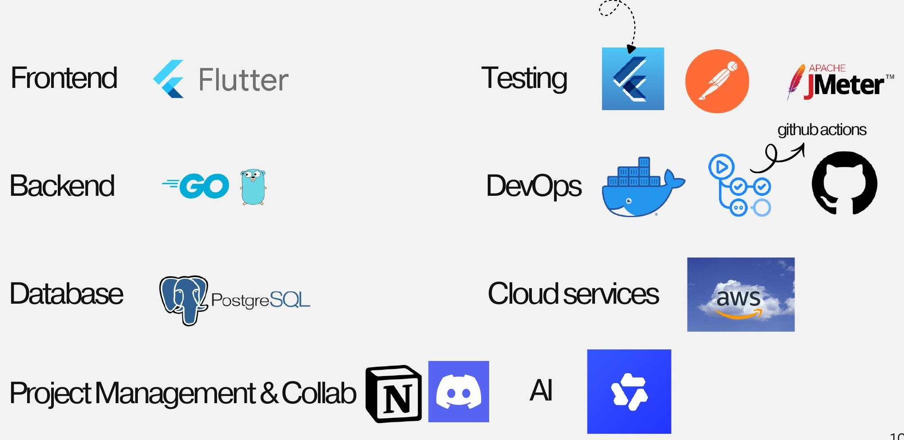

# Tech Stack

<figure><figcaption>
Tech Stack ของ Lukchang Move
</figcaption></figure>

| ส่วน | เทคโนโลยี | ใช้ทำอะไร |
| --- | --- | --- |
| Frontend | Flutter | แอปผู้ส่งและผู้ขับ (iOS / Android) จาก codebase เดียว |
| Backend | Go | บริการ Job, Matching, Payment, Location, Chat + AI และ Admin API |
| Database | PostgreSQL (Aurora), Redis (ElastiCache) | ข้อมูลธุรกรรมหลัก และ GEO index |
| AI / LLM | Decision Tree + TF-IDF, Qwen บน vLLM | AI Support Chatbot แบบ Hybrid |
| Testing | flutter test, integration test, Postman, Apache JMeter | ทดสอบแอป API และ load test |
| DevOps | Docker, GitHub Actions | build image และ CI/CD |
| Cloud | AWS (ap-southeast-7 Bangkok) | รันระบบ production ทั้งหมดบน customer request path |
| Project Management | Notion | วางแผนงาน บันทึกประชุม และติดตามงานแต่ละทีม |
| Collaboration | Discord | สื่อสารภายในทีม |


**[เติม]** เหตุผลที่เลือกแต่ละเทคโนโลยี เช่น ทำไมเลือก Flutter แทน native หรือทำไมเลือก Go

