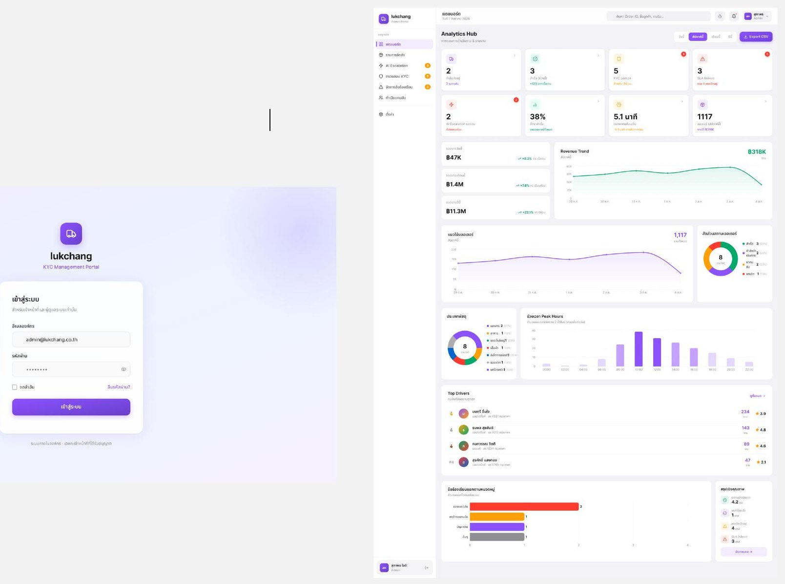
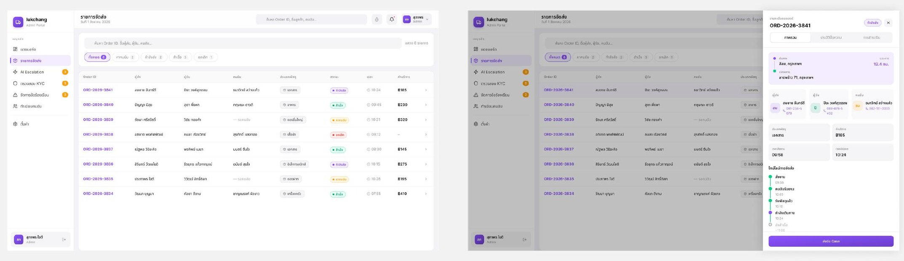
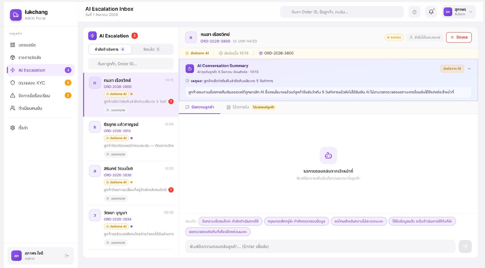
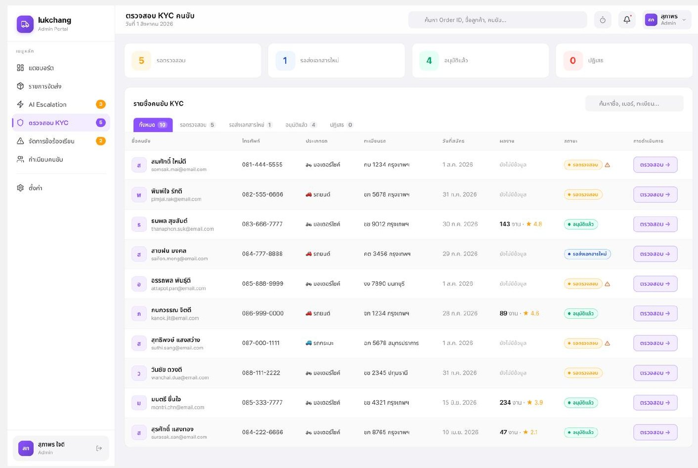
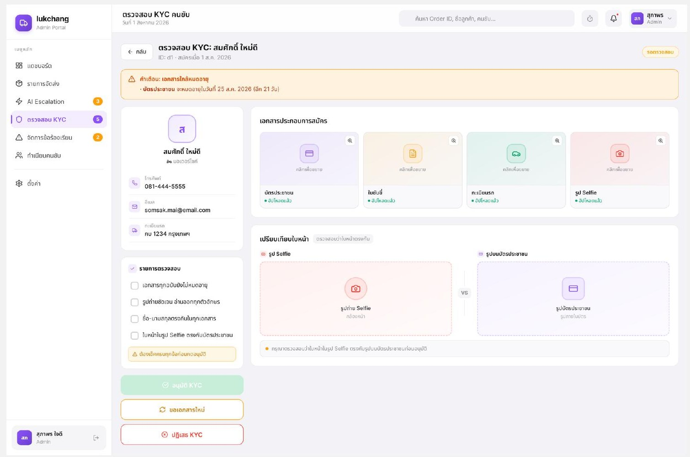
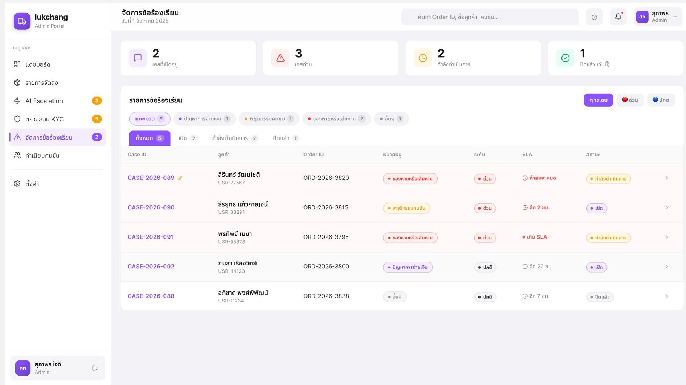
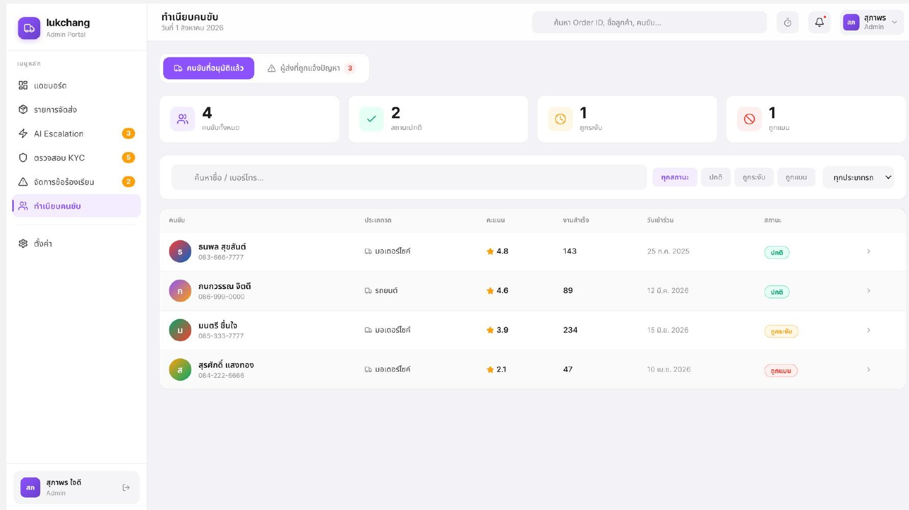

# Admin

Admin ใช้งานผ่าน **KYC Management Dashboard** บน Web browser สำหรับตรวจสอบ แก้ปัญหา และดูข้อมูลหลังบ้าน

<figure><figcaption>
KYC Management Dashboard
</figcaption></figure>

| ส่วน | หน้าที่ |
| --- | --- |
| จำนวนออเดอร์ | ดูภาพรวมจำนวนออเดอร์ในระบบ |
| รายได้ | ดูสรุปรายได้ของแพลตฟอร์ม |
| ตรวจเอกสารผู้ขับ | ตรวจเอกสาร KYC ก่อนอนุมัติให้ผู้ขับรับงาน เป็นหัวใจที่ทำให้ผู้ส่งไว้ใจผู้ขับได้ |
| AI Escalation Inbox | รวมเคสที่ Chatbot ส่งต่อมา (Tier 2B และ Tier 3) ให้ Admin ตรวจตาม SLA |

## หน้าจอแต่ละส่วน

ภาพรายละเอียดด้านล่างมาจากงานออกแบบใน Progress 2



<figure><figcaption>
หน้าเข้าสู่ระบบและ Analytics Hub
</figcaption></figure>

หน้า Analytics Hub แสดงจำนวนออเดอร์ รายได้ แนวโน้มรายได้ สัดส่วนสถานะงาน และผู้ขับยอดนิยม



<figure><figcaption>
รายการออเดอร์และรายละเอียดออเดอร์
</figcaption></figure>

ค้นหาและกรองออเดอร์ตามสถานะ กดเปิดดูรายละเอียด แชท และราคาของแต่ละงาน



<figure><figcaption>
AI Escalation Inbox
</figcaption></figure>

รวมเคสที่ Chatbot ส่งต่อ พร้อม AI Conversation Summary ระดับความเร่งด่วน และ SLA ให้ Admin ตอบต่อในแชทเดียวกัน



<figure><figcaption>
รายการผู้ขับที่รอตรวจ KYC
</figcaption></figure>

<figure><figcaption>
หน้าตรวจเอกสาร KYC ของผู้ขับ
</figcaption></figure>

Admin เปิดดูเอกสารแต่ละใบ ติ๊ก checklist แล้วกดอนุมัติหรือปฏิเสธ



<figure><figcaption>
รายการปัญหาที่ผู้ใช้แจ้ง
</figcaption></figure>

แยก ticket ตามสถานะและความเร่งด่วน พร้อมตัวนับ SLA



<figure><figcaption>
จัดการผู้ขับ
</figcaption></figure>

ดูรายชื่อผู้ขับ คะแนน จำนวนงาน และสถานะบัญชี



เอกสาร KYC ของผู้ขับเก็บไว้ที่ on-prem (Synology NAS ใน Private Datacenter) นอก critical request path ดูรายละเอียดที่ [Server & Storage](../datacenter/server-storage.md)
