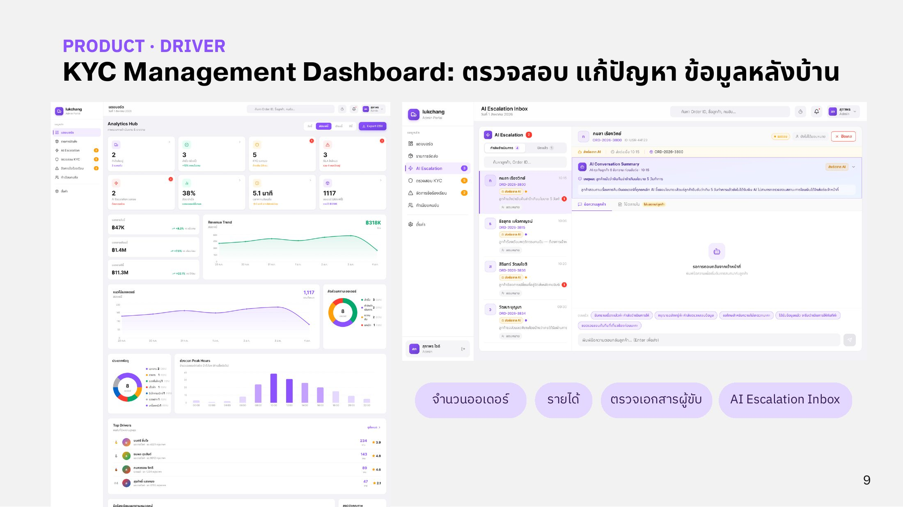

# Admin

Admin ใช้งานผ่าน **KYC Management Dashboard** บน Web browser สำหรับตรวจสอบ แก้ปัญหา และดูข้อมูลหลังบ้าน

<figure><figcaption>
KYC Management Dashboard
</figcaption></figure>

| ส่วน | หน้าที่ |
| --- | --- |
| จำนวนออเดอร์ | ดูภาพรวมจำนวนออเดอร์ในระบบ |
| รายได้ | ดูสรุปรายได้ของแพลตฟอร์ม |
| ตรวจเอกสารผู้ขับ | ตรวจเอกสาร KYC ก่อนอนุมัติให้ผู้ขับรับงาน เป็นหัวใจที่ทำให้ผู้ส่งไว้ใจผู้ขับได้ |
| AI Escalation Inbox | รวมเคสที่ Chatbot ส่งต่อมา (Tier 2B และ Tier 3) ให้ Admin ตรวจตาม SLA |

เอกสาร KYC ของผู้ขับเก็บไว้ที่ on-prem (Synology NAS ใน Private Datacenter) นอก critical request path ดูรายละเอียดที่ [Server & Storage](../datacenter/server-storage.md)
