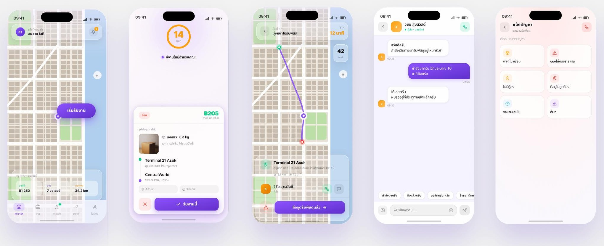
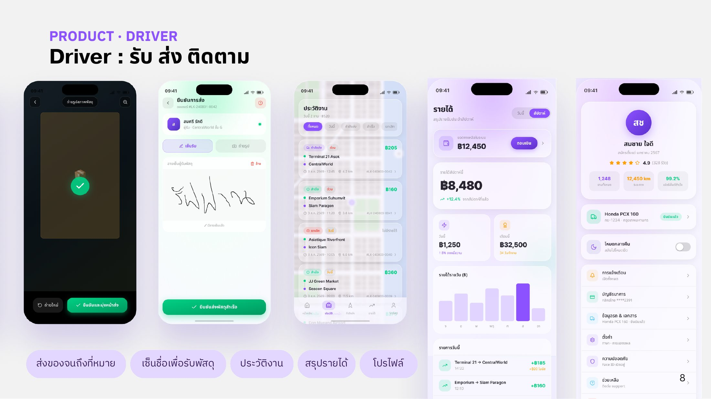

# Driver

แอปผู้ขับครอบคลุมการรับงาน ส่งของ และติดตามรายได้



<figure><figcaption>
รับงาน ดูงานที่กำลังจะส่ง แชทกับ Sender และแจ้งปัญหา
</figcaption></figure>

* **รับงาน:** ดูรายการงานที่เข้ามาพร้อมข้อมูลพัสดุ แล้วกดรับงาน
* **งานที่กำลังจะส่ง:** ดูรายละเอียดจุดรับ จุดส่ง และพัสดุ
* **แชทกับ Sender:** สื่อสารกับผู้ส่งได้ในแอป
* **แจ้งปัญหา:** ถ้าเจอปัญหาระหว่างทาง กดแจ้งได้ทันที



<figure><figcaption>
ส่งของถึงที่หมาย เซ็นชื่อรับพัสดุ ประวัติงาน สรุปรายได้ และโปรไฟล์
</figcaption></figure>

* **ส่งของจนถึงที่หมาย:** นำทางไปยังปลายทาง
* **เซ็นชื่อเพื่อรับพัสดุ:** ผู้รับเซ็นชื่อยืนยันในแอป เป็นหลักฐานการส่งมอบ
* **ประวัติงาน, สรุปรายได้ และโปรไฟล์:** ผู้ขับดูงานย้อนหลังและรายได้ของตัวเองได้


