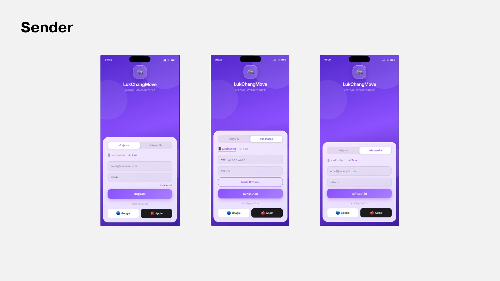
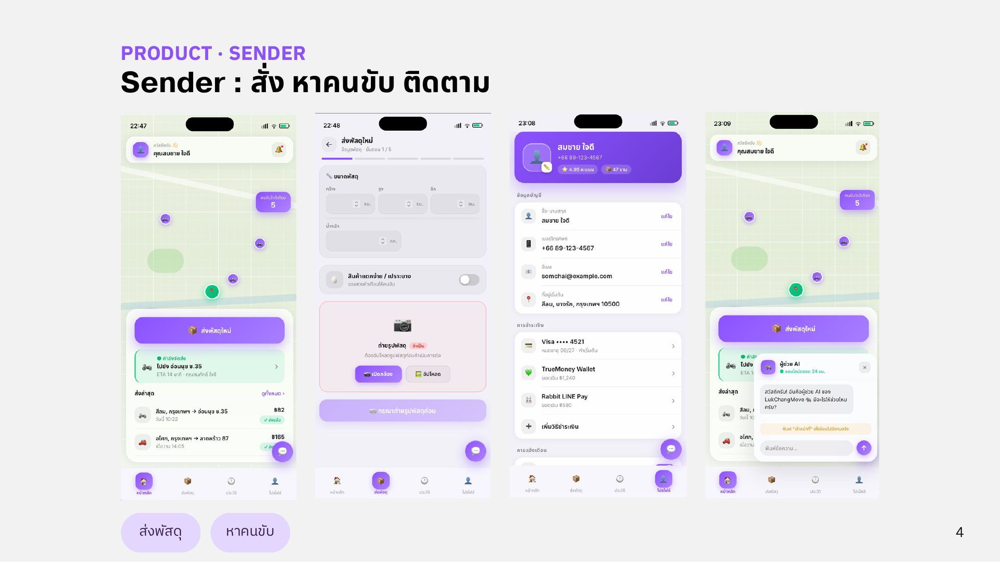
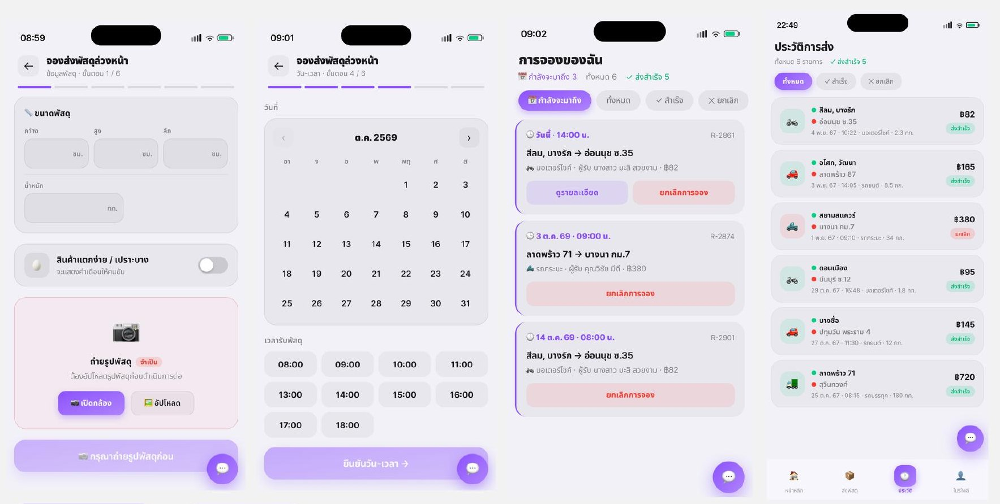
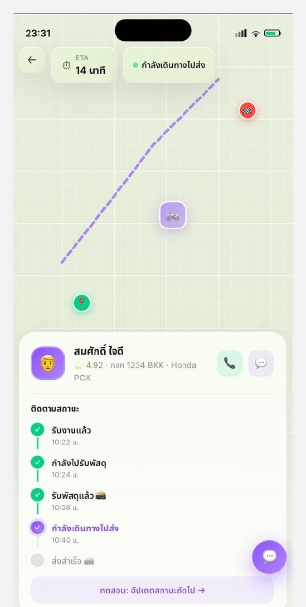
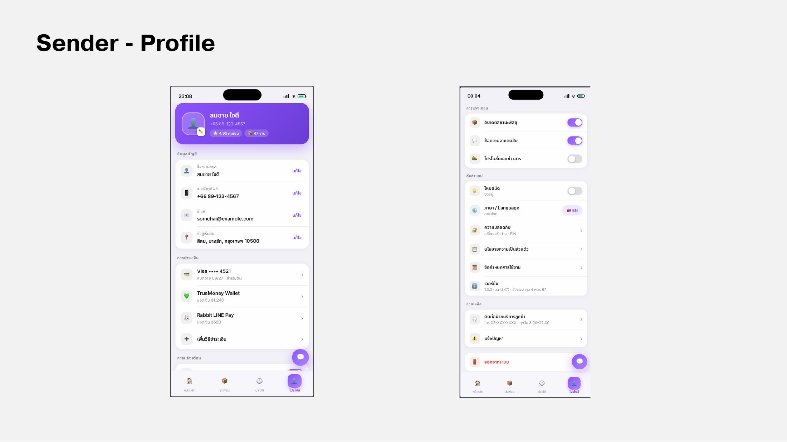

# Sender

แอปผู้ส่งครอบคลุมการสั่ง หาคนขับ และติดตามพัสดุ



<figure><figcaption>
หน้าเข้าสู่ระบบและสมัครสมาชิก (Progress 2)
</figcaption></figure>

ผู้ส่งเข้าสู่ระบบด้วยอีเมลหรือเบอร์โทรศัพท์ (ยืนยันด้วย OTP) หรือใช้บัญชี Google / Apple



<figure><figcaption>
หน้าส่งพัสดุและหาคนขับ
</figcaption></figure>

ผู้ส่งเริ่มจากสร้างรายการส่ง ใส่ขนาด จำนวน และประเภทพัสดุ จากนั้นระบบช่วยหาคนขับให้ ทุกขั้นตอนอยู่ในแอปเดียว ไม่ต้องไปหาคนขนของในโซเชียลมีเดีย



<figure><figcaption>
จองพัสดุล่วงหน้าและประวัติการส่ง
</figcaption></figure>

การจองล่วงหน้าแบ่งเป็น 6 ขั้นตอน



### ข้อมูลพัสดุ
กรอกขนาด กว้าง × สูง × ลึก (ซม.) และน้ำหนัก (กก.) เลือกว่าเป็นสินค้าแตกง่าย/เปราะบางหรือไม่ (ระบบจะแสดงคำเตือนให้คนขับ) และต้องถ่ายรูปหรืออัปโหลดรูปพัสดุก่อนดำเนินการต่อ


### ประเภทยานพาหนะ
เลือกประเภทยานพาหนะตามขนาดและน้ำหนักพัสดุของคุณ


### ที่อยู่
ระบุที่อยู่ต้นทางที่จะให้ไปรับพัสดุ และปลายทางที่จะให้ไปส่ง


### วัน-เวลา
เลือกวันที่จากปฏิทิน และเลือกเวลารับพัสดุตั้งแต่ 08:00 ถึง 18:00


### ข้อมูลผู้รับ
ระบุชื่อผู้รับ เบอร์โทรผู้รับ และหมายเหตุถึงคนขับ


### สรุปรายการ
แสดงรายละเอียดทั้งหมดที่ระบุไว้ก่อนหน้า เพื่อเตรียมไปชำระเงินต่อไป



**การจองของฉัน:** แยกแท็บ กำลังจะมาถึง / ทั้งหมด / สำเร็จ / ยกเลิก แต่ละรายการแสดงเวลา เส้นทาง ประเภทรถ ผู้รับ และราคา พร้อมปุ่มดูรายละเอียดและยกเลิกการจอง



<figure><figcaption>
หน้าติดตามสถานะพร้อมแผนที่และ ETA
</figcaption></figure>

เมื่อมีผู้ขับรับงาน ผู้ส่งเห็นตำแหน่งผู้ขับบนแผนที่ ETA และข้อมูลผู้ขับ (ชื่อ คะแนน ทะเบียนรถ รุ่นรถ) พร้อมปุ่มโทรและแชท สถานะแบ่งเป็นลำดับดังนี้



### ขั้นที่ 1
รับงานแล้ว


### ขั้นที่ 2
กำลังไปรับพัสดุ


### ขั้นที่ 3
รับพัสดุแล้ว (มีรูปถ่าย)


### ขั้นที่ 4
กำลังเดินทางไปส่ง


### ขั้นที่ 5
ส่งสำเร็จ (มีรูปถ่าย)



ข้อมูลตำแหน่งจัดการผ่าน **Amazon Location Service** ซึ่งรองรับแผนที่ การติดตาม และ Geofencing โดยเก็บพิกัด Latitude/Longitude เวลาที่บันทึก รหัสอุปกรณ์/ผู้ใช้ และประวัติการเดินทาง พร้อมกำหนดสิทธิ์และระยะเวลาการจัดเก็บข้อมูลให้ชัดเจน

<figure><figcaption>
หน้าติดตามสถานะพัสดุ
</figcaption></figure>



<figure><figcaption>
โปรไฟล์และการตั้งค่า (Progress 2)
</figcaption></figure>

* ข้อมูลบัญชี: ชื่อ เบอร์โทร อีเมล และที่อยู่เริ่มต้น แก้ไขได้
* วิธีชำระเงิน: บัตร, TrueMoney Wallet, Rabbit LINE Pay และเพิ่มวิธีใหม่ได้
* การแจ้งเตือน ภาษา และการตั้งค่าอื่นๆ


