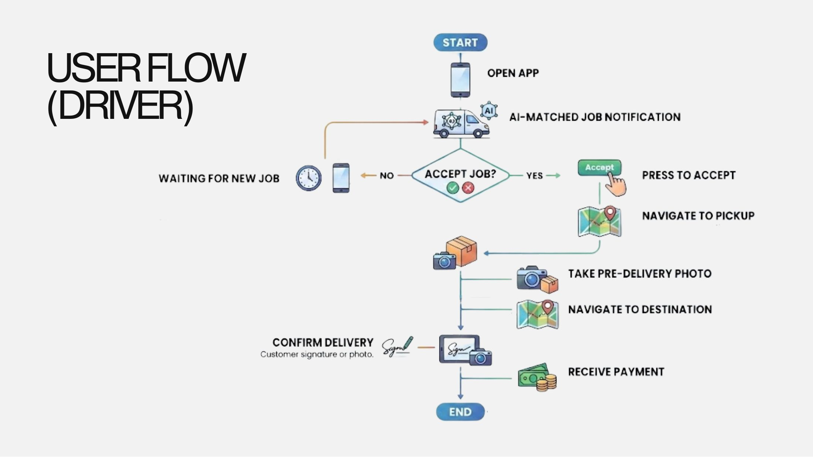
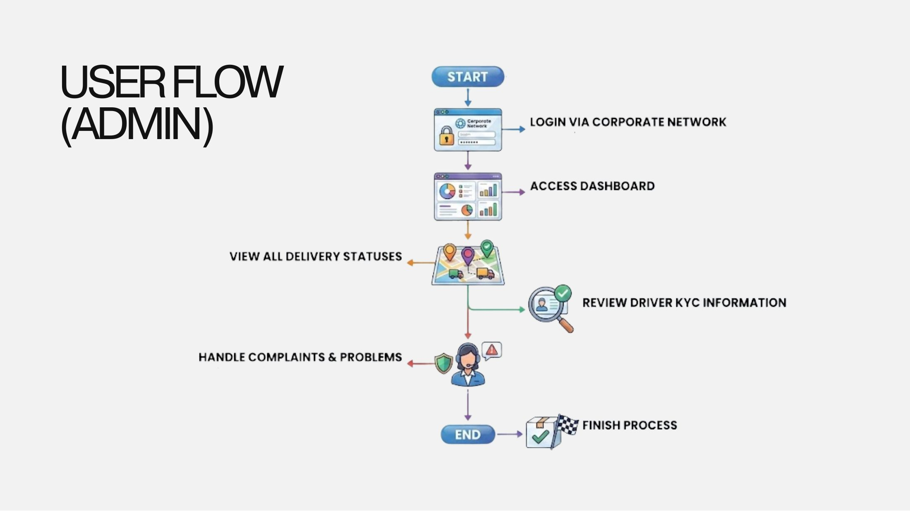
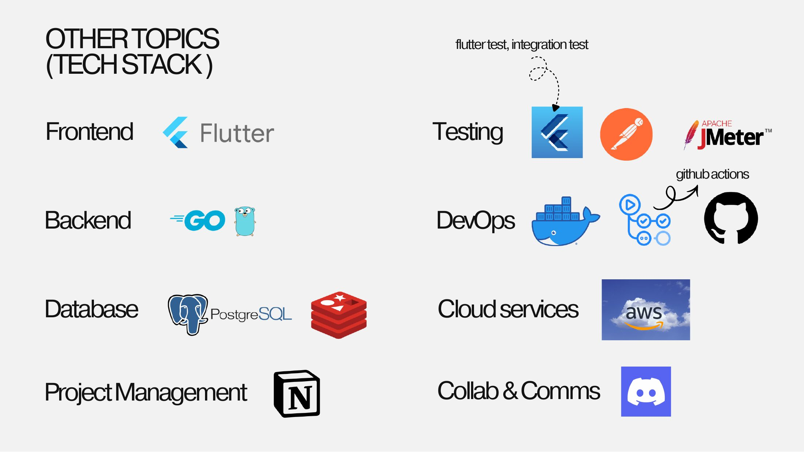

# User Flow

## Sender

<figure><figcaption>
User Flow ของผู้ส่ง
</figcaption></figure>

1. เปิดแอป แล้วระบุประเภทพัสดุ
2. ถ้ารู้ขนาดพัสดุ ให้กรอกขนาด จำนวน และปลายทาง แล้วเลือกขนาดรถ
3. ถ้าไม่รู้ขนาด ให้ถ่ายรูปพัสดุและระบุปลายทาง (Proposal วางแผนให้ AI ประเมินขนาดและแนะนำขนาดรถ)
4. ระบบแสดงราคาประเมิน ผู้ส่งยืนยันและชำระเงิน
5. รอคนขับมารับ แล้วติดตามสถานะแบบ real-time
6. พัสดุถึงปลายทาง จบขั้นตอน

## Driver

<figure><figcaption>
User Flow ของผู้ขับ
</figcaption></figure>

1. เปิดแอป แล้วรับแจ้งเตือนงานที่ระบบจับคู่ให้
2. ถ้าไม่รับงาน จะกลับไปรองานใหม่
3. ถ้ารับงาน กดยอมรับ แล้วนำทางไปจุดรับพัสดุ
4. ถ่ายรูปพัสดุก่อนส่ง แล้วนำทางไปปลายทาง
5. ยืนยันการส่งมอบด้วยลายเซ็นหรือรูปถ่ายของผู้รับ
6. รับเงิน จบขั้นตอน

## Admin

<figure><figcaption>
User Flow ของ Admin
</figcaption></figure>

1. ล็อกอินผ่านเครือข่ายบริษัท
2. เข้า Dashboard แล้วดูสถานะการจัดส่งทั้งหมด
3. ตรวจข้อมูล KYC ของผู้ขับ
4. จัดการคำร้องเรียนและปัญหา
5. จบขั้นตอน
